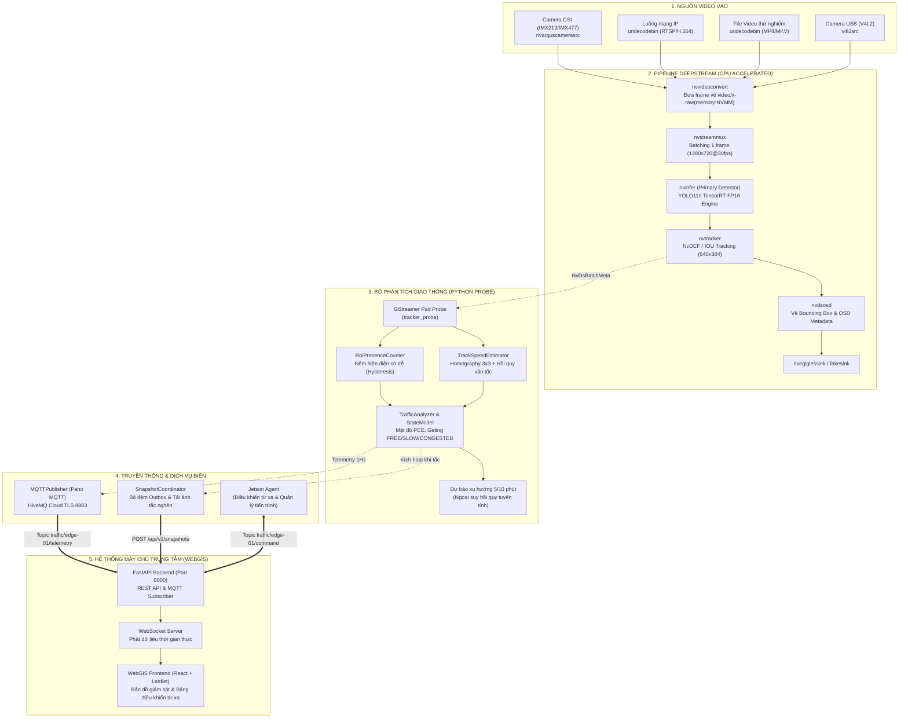

# BÁO CÁO TIẾN ĐỘ ĐỀ TÀI NGHIÊN CỨU & PHÁT TRIỂN HỆ THỐNG
**HỆ THỐNG AIoT GIÁM SÁT VÀ PHÂN TÍCH GIAO THÔNG THÔNG MINH TRÊN THIẾT BỊ BIÊN JETSON NANO VÀ DEEPSTREAM**

* **Người thực hiện:** [SINH VIÊN ĐIỀN HỌ VÀ TÊN]
* **Mã số sinh viên:** [SINH VIÊN ĐIỀN MSSV]
* **Giảng viên hướng dẫn:** [SINH VIÊN ĐIỀN TÊN GVHD]
* **Thời gian báo cáo:** Tháng 10/2026
* **Môi trường thực nghiệm:** NVIDIA Jetson Nano B01 (4GB), JetPack 4.6.1, DeepStream SDK 6.0.1, TensorRT 8.2.1, Python 3.6.

---

## 1. Tổng quan kiến trúc hệ thống

Hệ thống được thiết kế theo mô hình **Edge AIoT phân tán**: Toàn bộ quá trình giải mã video, phát hiện phương tiện, theo vết đối tượng và tính toán các đại lượng giao thông (vận tốc, mật độ, lưu lượng, phân loại ùn tắc) được thực thi hoàn toàn cục bộ trên thiết bị biên **NVIDIA Jetson Nano**. Máy chủ trung tâm (WebGIS Backend) chỉ tiếp nhận các gói tin siêu dữ liệu (telemetry) nhẹ qua giao thức MQTT và ảnh chụp minh chứng khi xảy ra ùn tắc (congestion snapshot) qua giao thức HTTP POST.

### Sơ đồ luồng dữ liệu tổng thể (Dataflow Pipeline)

---

## 2. Chi tiết các phân hệ tại tầng thiết bị biên (Jetson Edge AI)

### a. Phân hệ thu nhận video (Video Ingestion)

Phân hệ thu nhận video có nhiệm vụ mở nguồn cấp dữ liệu hình ảnh, chuẩn hóa định dạng pixel và đưa thẳng khung hình vào bộ nhớ hợp nhất của GPU (bộ nhớ **NVMM - NVIDIA Memory Management**) để các phần tử tính toán phía sau không phải sao chép qua lại giữa RAM hệ thống và VRAM.

| Chức năng | Mô tả ngắn | Công nghệ / Thuật toán | Vị trí mã nguồn (File:Hàm/Dòng) | Trạng thái |
| :--- | :--- | :--- | :--- | :--- |
| Thu nhận Camera CSI | Đọc trực tiếp luồng phần cứng từ cổng MIPI-CSI qua daemon Argus của NVIDIA | Phần tử GStreamer `nvarguscamerasrc` | `core/gstreamer_builder.py:349-375` | Đã triển khai |
| Thu nhận File video | Đọc và giải mã file video MP4, MKV, H.264 từ bộ nhớ đĩa | Phần tử GStreamer `uridecodebin` tự động liên kết pad | `core/gstreamer_builder.py:376-410` | Đã triển khai |
| Thu nhận Luồng RTSP | Mở luồng camera mạng IP qua giao thức RTSP | GStreamer `uridecodebin` với cơ chế reconnect | `core/gstreamer_builder.py:378-382` | Đã có code, chưa kiểm chứng trên thiết bị |
| Thu nhận Camera USB | Đọc camera chuẩn V4L2 qua cổng USB | Phần tử GStreamer `v4l2src` kết hợp `videoconvert` | `core/gstreamer_builder.py:413-442` | Đã triển khai |
| Chuẩn hóa bộ nhớ NVMM | Ép khung hình về không gian màu NV12, độ phân giải 1280x720 và nạp vào NVMM | `nvvideoconvert` + `capsfilter` (`video/x-raw(memory:NVMM)`) | `core/gstreamer_builder.py:353-370` | Đã triển khai |

*Giải thích bổ sung:*  
Trên dòng vi xử lý Tegra của Jetson Nano, CPU và GPU dùng chung một thanh RAM vật lý nhưng chia thành hai không gian địa chỉ. Bộ nhớ **NVMM** là cơ chế phần cứng cho phép các lõi tăng tốc video (NVDEC, NVENC, VIC) và lõi CUDA truy cập trực tiếp khung hình mà không cần CPU sao chép trung gian, giúp giảm tối đa độ trễ và tiết kiệm băng thông bus bộ nhớ.

---

### b. Phân hệ phát hiện đối tượng (Object Detection)

| Chức năng | Mô tả ngắn | Công nghệ / Thuật toán | Vị trí mã nguồn (File:Hàm/Dòng) | Trạng thái |
| :--- | :--- | :--- | :--- | :--- |
| Thực thi suy luận Deep Learning | Chạy mô hình phát hiện phương tiện tốc độ cao trên phần cứng GPU | NVIDIA TensorRT FP16 qua phần tử DeepStream `nvinfer` (PGIE) | `core/gstreamer_builder.py:444-450`, `configs/config_infer_yolo11_nano.txt` | Đã triển khai |
| Điều phối chu kỳ suy luận (Interval) | Bỏ qua suy luận xen kẽ 1 khung hình để tăng gấp đôi FPS, giao khung giữa cho tracker | Tham số `interval=1` trong PGIE (tùy biến qua CLI `--interval`) | `configs/config_infer_yolo11_nano.txt:10`, `main.py:378` | Đã triển khai |
| Định dạng mô hình | Kiến trúc YOLO11n (theo sinh viên: huấn luyện tiếp từ COCO), đóng băng trọng số sang ONNX và biên dịch thành Engine | TensorRT Engine (`exp.engine`), cấu hình nạp tại `model-engine-file` | `configs/config_infer_yolo11_nano.txt:4-5` | Đã triển khai |
| Phân loại 7 nhóm đối tượng | Nhận diện 7 lớp phương tiện và yếu tố giao thông đặc thù | Đọc danh mục lớp từ `configs/labels_custom.txt` | `configs/labels_custom.txt:1-7` | Đã triển khai |
| Giải mã Bounding Box tùy biến | Trích xuất tọa độ hộp bao và điểm tin cậy từ tensor đầu ra của YOLO | Thư viện C++ tùy biến `libnvdsinfer_custom_impl_Yolo.so`, hàm `NvDsInferParseYolo` | `configs/config_infer_yolo11_nano.txt:16-18` | Đã triển khai |
| Lọc trùng lặp NMS | Loại bỏ các hộp bao chồng lấn trên cùng một đối tượng | Non-Maximum Suppression (`nms-iou-threshold=0.45`, `pre-cluster-threshold=0.25`) | `configs/config_infer_yolo11_nano.txt:21-22` | Đã triển khai |

*Chi tiết 7 lớp đối tượng được cấu hình:*
1. `bicycle` (Xe đạp)
2. `bus` (Xe buýt / Xe khách lớn)
3. `car` (Xe ô tô con / Xe taxi)
4. `motorbike` (Xe mô tô, xe gắn máy)
5. `people` (Người đi bộ)
6. `truck` (Xe tải các loại)
7. `vehicle_fire` (Phương tiện có dấu hiệu cháy nổ / sự cố khẩn cấp)

*Giải thích bổ sung:*  
* Mô hình YOLO chạy ở chế độ nửa độ chính xác **FP16** (`network-mode=2`), tận dụng các lõi FP16 CUDA của GPU Maxwell trên Jetson Nano để đạt tốc độ suy luận nhanh gần gấp đôi so với chế độ số thực FP32 truyền thống mà không làm suy giảm đáng kể độ chính xác nhận diện.
* **Cơ chế Inference Interval (`interval=1`):** Để đạt mục tiêu xử lý mượt mà 20–25 FPS trên phần cứng giới hạn của Jetson Nano, mô hình suy luận được cấu hình chạy xen kẽ 1 khung hình (khung 0, 2, 4...). Các khung hình ở giữa (khung 1, 3, 5...) sẽ do thuật toán NvDCF Tracker tiếp quản để duy trì vị trí và tốc độ với thời gian tính toán chỉ ~3ms (thay vì 45–50ms nếu phải chạy mạng nơ-ron toàn bộ). Cơ chế này giúp nhân đôi thông lượng xử lý mà không làm mất dấu vết phương tiện.

---

### c. Phân hệ theo vết đối tượng (Multi-Object Tracking)

| Chức năng | Mô tả ngắn | Công nghệ / Thuật toán | Vị trí mã nguồn (File:Hàm/Dòng) | Trạng thái |
| :--- | :--- | :--- | :--- | :--- |
| Theo vết đa đối tượng | Gán và duy trì định danh duy nhất (Track ID) xuyên suốt các khung hình | NVIDIA NvDCF (Discriminative Correlation Filter) qua `nvtracker` | `core/gstreamer_builder.py:449-457`, `configs/config_tracker_optimized.yml` | Đã triển khai |
| Ước lượng trạng thái chuyển động | Dự đoán quỹ đạo và bù trừ độ rung lắc của hộp bao | Bộ lọc Kalman (Kalman Filter State Estimator, type 1) | `configs/config_tracker_optimized.yml:24-28` | Đã triển khai |
| Theo vết khi bị che khuất | Duy trì đối tượng trong bộ nhớ tạm khi phương tiện bị xe khác che khuất ngắn hạn | Shadow Tracking (`maxShadowTrackingAge=15` khung hình) | `configs/config_tracker_optimized.yml:20` | Có hạn chế |
| Tối ưu hóa tải tính toán | Giảm kích thước ảnh đưa vào bộ trích xuất đặc trưng visual | Giới hạn độ phân giải tracker xuống `640x384` | `core/gstreamer_builder.py:453-454` | Đã triển khai |
| Bộ cấu hình dự phòng IOU | Theo vết thuần hình học dựa trên tỷ lệ giao diện hộp bao, tiêu tốn cực ít CPU | Giao thoa diện tích Intersection over Union (IOU Tracker) | `configs/config_tracker_IOU.yml` | Đã triển khai |

*Giải thích bổ sung:*  
**Shadow tracking** là cơ chế giúp hệ thống không bị "quên" một chiếc xe máy khi nó tạm thời đi khuất sau đuôi một chiếc xe buýt. Bộ lọc Kalman sẽ tiếp tục ngoại suy vị trí của xe trong tối đa 15 khung hình (khoảng 0.5 giây) cho đến khi xe xuất hiện trở lại mà không cấp một Track ID mới.

---

### d. Phân hệ quản lý vùng quan tâm (ROI Management)

| Chức năng | Mô tả ngắn | Công nghệ / Thuật toán | Vị trí mã nguồn (File:Hàm/Dòng) | Trạng thái |
| :--- | :--- | :--- | :--- | :--- |
| Phân định 2 cấp độ ROI | Tách biệt vùng phát hiện rộng (Detection ROI) và vùng đo đạc giao thông (Analysis ROI) | Đa giác lồi 2D chuẩn hóa hệ tọa độ `[0.0, 1.0]` | `analytics/presence_counter.py:26-35`, `main.py:726-739` | Đã triển khai |
| Xác định điểm neo phương tiện | Lấy trung điểm đáy của hộp bao đại diện cho điểm tiếp xúc bánh xe mặt đường | Phép tính hình học: $P_{\text{anchor}} = \left(\frac{x_{\min} + x_{\max}}{2}, y_{\max}\right)$ | `spatial/geometry_utils.py:bbox_bottom_center`, `analytics/speed_estimator.py:32-34` | Đã triển khai |
| Kiểm tra điểm trong đa giác | Xác định xem vị trí bánh xe có nằm trong lòng khu vực đo hay không | Thuật toán Ray-casting (bắn tia kiểm tra số giao điểm chẵn/lẻ) | `spatial/geometry_utils.py:point_in_polygon` | Đã triển khai |
| Đếm hiện diện có độ trễ | Chống đếm trùng/nhấp nháy do mép hộp bao rung lắc ở ranh giới | Bộ lọc trễ Hysteresis: vào trễ 0.10s, ra trễ 0.25s, mất track 1.0s | `analytics/presence_counter.py:RoiPresenceCounter` | Đã triển khai |
| Cập nhật ROI không cần dừng hệ thống | Thay đổi tọa độ vùng vẽ ROI từ xa ngay trong lúc pipeline đang phân tích | Nạp động ma trận qua hàm `update_geometry()` | `analytics/presence_counter.py:43-46`, `main.py:195-202` | Đã triển khai |

*Giải thích bổ sung:*  
**Hysteresis (độ trễ chống rung)** là kỹ thuật cần thiết trong thị giác máy tính: Nếu một xe dừng ngay vạch kẻ ranh giới, hộp bao có thể dịch chuyển 1-2 pixel giữa các khung hình. Thay vì làm hệ thống liên tục ghi nhận "xe vào" rồi "xe ra", cơ chế này bắt buộc xe phải ở hẳn trong vùng tối thiểu 0.10 giây mới tính là vào, và phải ra hẳn ngoài 0.25 giây mới tính là rời đi.

---

### e. Phân hệ ước lượng tốc độ phương tiện (Speed Estimation)

| Chức năng | Mô tả ngắn | Công nghệ / Thuật toán | Vị trí mã nguồn (File:Hàm/Dòng) | Trạng thái |
| :--- | :--- | :--- | :--- | :--- |
| Hiệu chuẩn phối cảnh Homography | Thiết lập ma trận ánh xạ 3x3 từ mặt phẳng ảnh camera (pixel) sang mặt đường thực tế (mét) | Giải hệ phương trình 8 ẩn bằng phân rã nghiệm đại số tuyến tính `np.linalg.solve` | `analytics/speed_estimator.py:PerspectiveCalibration:103-128` | Đã triển khai |
| Kiểm tra tính hợp lệ tứ giác | Đảm bảo 4 điểm hiệu chuẩn không bị xoắn, không thẳng hàng và xếp đúng chiều | Tích có hướng 2D (`_cross product`) xác định tính lồi | `analytics/speed_estimator.py:72-100` | Đã triển khai |
| Chuyển đổi tọa độ thế giới | Chiếu tọa độ đáy hộp bao sang tọa độ mét đường $X$ (ngang), $Y$ (dọc) | Phép chiếu tọa độ thuần nhất: $P_{\text{world}} = \frac{H \cdot P_{\text{img}}}{w}$ | `analytics/speed_estimator.py:130-150` | Đã triển khai |
| Tính toán vận tốc phẳng | Ước lượng vận tốc dịch chuyển bằng hồi quy tuyến tính trên chuỗi vị trí thực tế | Hồi quy OLS (Ordinary Least Squares) trên trục tọa độ mét theo thời gian $t$ | `analytics/speed_estimator.py:TrackSpeedEstimator:252-267` | Đã triển khai |
| Bộ lọc nhiễu & giá trị phi vật lý | Loại trừ sai số do tracking giật cục, lọc rung giật hộp bao của xe đỗ cố định | Lọc thời gian $\ge 0.8\text{s}$, quãng đường $\ge 1.5\text{m}$ (chống trôi xe đỗ), vận tốc $< 130\text{ km/h}$, spike $< 260\text{ km/h}$ | `analytics/speed_estimator.py:220-236, 355-365` | Đã triển khai |
| Làm mượt vận tốc theo thời gian | Giảm hiện tượng nhảy số vận tốc giữa các frame liên tiếp | Bộ lọc trung bình trượt hàm mũ EMA ($\alpha = 0.25$) | `analytics/speed_estimator.py:330-336` | Đã triển khai |
| Chuẩn hóa mốc thời gian DeepStream | Khắc phục hiện tượng mốc thời gian PTS của DeepStream bị đứt quãng hoặc âm | Bộ phân giải đồng hồ đơn điệu `StreamTimestamp` dựa trên FPS danh định | `analytics/speed_estimator.py:StreamTimestamp:160-210` | Đã triển khai |

#### Chi tiết toán học của phép ước lượng vận tốc:

1. **Ma trận phối cảnh $3 \times 3$ ($H$):**
$$\begin{bmatrix} x_w \\ y_w \\ 1 \end{bmatrix} \sim \begin{bmatrix} h_{00} & h_{01} & h_{02} \\ h_{10} & h_{11} & h_{12} \\ h_{20} & h_{21} & 1 \end{bmatrix} \begin{bmatrix} x_{\text{img}} \\ y_{\text{img}} \\ 1 \end{bmatrix}$$
Toạ độ mặt đường thực tế $(x_w, y_w)$ tính bằng:
$$x_w = \frac{h_{00} x_{\text{img}} + h_{01} y_{\text{img}} + h_{02}}{h_{20} x_{\text{img}} + h_{21} y_{\text{img}} + 1}, \quad y_w = \frac{h_{10} x_{\text{img}} + h_{11} y_{\text{img}} + h_{12}}{h_{20} x_{\text{img}} + h_{21} y_{\text{img}} + 1}$$

2. **Ước lượng vận tốc bằng hồi quy tuyến tính:**
Thay vì chỉ lấy khoảng cách giữa điểm đầu và điểm cuối (rất dễ bị sai lệch do rung hộp bao), hệ thống thu thập tập hợp vị trí $\{(t_i, x_{w,i}, y_{w,i})\}$ trong cửa sổ lịch sử 2.0 giây và tính độ dốc chuyển động:
$$v_x = \frac{\sum_{i=1}^N (t_i - \bar{t})(x_{w,i} - \bar{x}_w)}{\sum_{i=1}^N (t_i - \bar{t})^2}, \quad v_y = \frac{\sum_{i=1}^N (t_i - \bar{t})(y_{w,i} - \bar{y}_w)}{\sum_{i=1}^N (t_i - \bar{t})^2}$$
Vận tốc tổng hợp tính theo đơn vị km/h:
$$v = \sqrt{v_x^2 + v_y^2} \times 3.6$$

3. **Làm mượt số mũ (Exponential Moving Average):**
$$v_{\text{smooth}}^{(t)} = \alpha \cdot v_{\text{raw}}^{(t)} + (1 - \alpha) \cdot v_{\text{smooth}}^{(t-1)} \quad (\text{với } \alpha = 0.25)$$

---

### f. Phân tích giao thông và nhận định ùn tắc (Traffic Analytics)

| Chức năng | Mô tả ngắn | Công nghệ / Thuật toán | Vị trí mã nguồn (File:Hàm/Dòng) | Trạng thái |
| :--- | :--- | :--- | :--- | :--- |
| Mật độ phương tiện quy đổi PCE | Tính mật độ chiếm dụng mặt đường quy đổi tương đương xe con (Passenger Car Equivalent) | Hệ số PCE: Xe máy 0.3, Xe đạp 0.2, Xe con 1.0, Xe tải 1.8, Xe khách 2.0 (TCVN 4054:2005) | `analytics/traffic_classifier.py:416-444` | Đã triển khai |
| Ước lượng lưu lượng dòng xe | Tính số lượt xe thông hành qua mặt cắt theo lý thuyết dòng giao thông cơ bản | Công thức thủy lực giao thông: $q = k \times v \times N_{\text{lane}}$ | `analytics/traffic_classifier.py:455-463` | Đã triển khai |
| Đếm số lượng xe dừng chờ | Xác định số lượng xe thực sự bị ùn ứ và chuẩn hóa mẫu số tránh phóng đại 100% | Lọc $v < 5.0\text{ km/h}$, bỏ qua xe chưa di chuyển và xe ngoài ROI; Mẫu số $\max(N_{\text{current}}, N_{\text{active\_speeds}})$ | `analytics/traffic_classifier.py:380-408` | Đã triển khai |
| Phân loại trạng thái Gating 4 cấp | Phân định trạng thái dòng xe thành `FREE`, `SLOW`, `CONGESTED` kết hợp bảo vệ đường vắng | Guard đường vắng + Free Flow Override + Moving Override + Congested Gate + Slow Flow | `analytics/traffic_classifier.py:150-197` | Đã triển khai |
| Khử rung lắc trạng thái | Giữ trạng thái giao thông ổn định, tránh đổi màu liên tục giữa xanh/vàng/đỏ | Bầu đa số (Majority Voting) trong cửa sổ trượt 10 giây | `analytics/traffic_classifier.py:126-140` | Đã triển khai |
| Tính điểm số kẹt xe (0 - 100) | Tính chỉ số tắc nghẽn định lượng kết hợp 3 thành phần vật lý và chặn trần an toàn | Tỷ trọng: 50% Vận tốc + 30% Tỷ lệ dừng + 20% Mật độ PCE; chặn trần $\le 15$ khi $\le 2$ xe | `analytics/traffic_classifier.py:199-245` | Đã triển khai |
| Dự báo xu hướng 5/10 phút | Dự đoán điểm số và trạng thái giao thông trong 5 và 10 phút tiếp theo | **Ngoại suy thống kê bằng hồi quy tuyến tính (Linear Regression)** trên chuỗi lịch sử điểm số | `analytics/traffic_classifier.py:495-565` | Đã triển khai |

#### Chi tiết công thức điểm số kẹt xe ($S_{\text{cong}}$) và cơ chế Gating đa tầng:

1. **Công thức tính tỷ lệ xe dừng ($R_{\text{stopped}}$) chống phóng đại:**
   $$R_{\text{stopped}} = \frac{N_{\text{stopped}}}{\max(N_{\text{current}}, N_{\text{active\_speeds}})}$$
   *Ý nghĩa:* Khi có xe mới tiến vào ROI và đang trong thời gian ổn định đo tốc độ (chưa có giá trị vận tốc tức thời), xe này vẫn được tính vào mẫu số để làm loãng tỷ lệ dừng, triệt tiêu lỗi báo sai $100\%$ xe dừng khi đường vắng chỉ có 2 xe đỗ ven đường và 1 xe đang chạy vào.

2. **Công thức điểm số 3 thành phần vật lý:**
   $$\text{Score} = S_{\text{speed}} + S_{\text{stopped}} + S_{\text{density}}$$
   Trong đó:
   * **Thành phần tốc độ ($S_{\text{speed}} \in [0, 50]$ điểm):**
     $$S_{\text{speed}} = \min\left(50, \max\left(0, 50 \times \left(1 - \frac{v_{\text{effective}}}{25.0}\right)\right)\right)$$
   * **Thành phần xe dừng ($S_{\text{stopped}} \in [0, 30]$ điểm):**
     $$S_{\text{stopped}} = \min\left(30, 30 \times \frac{R_{\text{stopped}}}{0.35}\right)$$
   * **Thành phần mật độ ($S_{\text{density}} \in [0, 20]$ điểm):**
     $$S_{\text{density}} = \min\left(20, 20 \times \frac{K_{\text{PCE}}}{K_{\text{congested}}}\right) \quad (\text{ngưỡng } K_{\text{congested}} = 220\text{ PCU/km/làn})$$

3. **Cơ chế Gating đa tầng (Hierarchical Gating Rules):**
   * **Cấp 0 (Low Vehicle Count Guard - Bảo vệ đường vắng):**  
     Nếu $N_{\text{current}} \le 2$: Ép trạng thái về `FREE` và **chặn trần điểm số kẹt xe $\text{Score} \le 15$ điểm** (về mặt vật lý giao thông, 1–2 xe dừng bên đường không thể cấu thành ùn tắc).  
     Nếu $N_{\text{current}} \le 4$ và mật độ $K_{\text{PCE}} < K_{\text{slow}}$: Tuyệt đối không xếp vào `CONGESTED`; nếu có xe chạy $\ge 20\text{ km/h}$, trạng thái chắc chắn là `FREE`.
   * **Cấp 1 (Free Flow Override - Dòng mao dẫn xe máy):**  
     Nếu vận tốc hiệu dụng $v_{\text{effective}} \ge 22\text{ km/h}$ và tỷ lệ dừng $R_{\text{stopped}} < 15\%$: Bắt buộc là `FREE`.
   * **Cấp 1.5 (Moving Vehicle Override - Ưu tiên phương tiện đang lưu thông):**  
     Khi mật độ thấp ($K_{\text{PCE}} < K_{\text{slow}}$) mà trong ROI có phương tiện chạy nhanh ($\ge 25\text{ km/h}$) hoặc tốc độ trung vị $\ge 22\text{ km/h}$, loại trừ hoàn toàn nhãn `CONGESTED`.
   * **Cấp 2 (Congested Gate - Cửa nhận diện ùn tắc nghiêm trọng):**  
     Chỉ kích hoạt khi dòng xe dừng bánh nặng ($R_{\text{stopped}} \ge 30\%$) hoặc vận tốc cực thấp ($v \le 10\text{ km/h}$) **kèm theo** mật độ cao ($K_{\text{PCE}} \ge 140 - 220\text{ PCU/km/làn}$) hoặc tỷ lệ dừng cục bộ $\ge 40\%$.
   * **Cấp 3 (Slow Flow):** Dòng xe chậm ($v \le 18\text{ km/h}$) hoặc mật độ vừa phải.
   * **Gating đồng bộ điểm số:**  
     * Nếu trạng thái là `FREE`: Ép điểm số $\le 30$ điểm (khi $N \le 2$, ép $\le 15$ điểm).
     * Nếu trạng thái là `SLOW`: Điểm số nằm trong khoảng $[35, 65]$ điểm.
     * Nếu trạng thái là `CONGESTED`: Điểm số $\ge 65$ điểm.

---

### g. Phân hệ truyền thông, giám sát & điều khiển từ xa (Communication)

| Chức năng | Mô tả ngắn | Công nghệ / Thuật toán | Vị trí mã nguồn (File:Hàm/Dòng) | Trạng thái |
| :--- | :--- | :--- | :--- | :--- |
| Xuất siêu dữ liệu giao thông Telemetry | Gửi báo cáo giao thông chi tiết định kỳ mỗi 1.0 giây lên Cloud | MQTT Publish qua TLS cổng 8883 (Topic: `traffic/{edge_id}/telemetry`) | `communication/mqtt_client.py:218-245`, `main.py:933-941` | Đã triển khai |
| Luồng nhịp tim Heartbeat | Báo cáo tình trạng sống còn và tài nguyên phần cứng định kỳ 30 giây | Luồng nền `HeartbeatThread` (Topic: `traffic/{edge_id}/heartbeat`) | `communication/mqtt_client.py:440-475` | Đã triển khai |
| Tiếp nhận lệnh điều khiển từ xa | Lắng nghe và điều phối các tác vụ điều khiển từ WebGIS qua MQTT | `CommandHandler` đăng ký danh mục hàm (Topic: `traffic/{edge_id}/command`) | `communication/command_router.py:40-105` | Đã triển khai |
| Danh mục lệnh an toàn (Whitelist) | Chỉ cho phép các lệnh được định nghĩa trước, ngăn chặn command injection | Whitelist: `list_videos`, `capture_preview`, `set_roi_remote`, `start_pipeline`, `stop_pipeline`... | `communication/command_router.py:30-38`, `communication/jetson_agent.py:717-730` | Đã triển khai |
| Chẩn đoán phần cứng Jetson | Đo đạc tải GPU, CPU, RAM, Swap, nhiệt độ chip, dung lượng ổ đĩa | Phân tích tập tin hệ thống `/sys/devices/virtual/thermal/` và `tegrastats` | `communication/system_metrics.py:20-150` | Đã triển khai |
| Tách biệt Client ID chống đá kết nối | Độc lập định danh client giữa Agent và Pipeline, loại trừ mã lỗi MQTT `rc=7` | `MQTT_AGENT_CLIENT_ID` (`edge-01-agent`) vs `MQTT_PIPELINE_CLIENT_ID` (`edge-01-pipeline`) | `main.py:74-75`, `communication/jetson_agent.py:675-713` | Đã triển khai |
| Gom cấu hình duy nhất | Nạp toàn bộ thông số từ 1 file `.env` duy nhất ở thư mục gốc | Tự động đọc và nạp biến môi trường từ `.env` cho mọi module | `main.py:59-75`, `config/settings.py:12-25`, `communication/jetson_agent.py:668-670` | Đã triển khai |

---

### h. Phân hệ chụp ảnh snapshot chứng minh ùn tắc (Congestion Snapshot)

| Chức năng | Mô tả ngắn | Công nghệ / Thuật toán | Vị trí mã nguồn (File:Hàm/Dòng) | Trạng thái |
| :--- | :--- | :--- | :--- | :--- |
| Tự động kích hoạt khi tắc kéo dài | Kích hoạt lưu bằng chứng khi trạng thái `CONGESTED` duy trì đủ lâu | Bộ đếm thời gian: xác nhận liên tục $\ge 15.0$ giây (`CONGESTION_CONFIRM_SECONDS`) | `snap/snapshot_service.py:220-250`, `tests/test_analytics.py:400-430` | Đã triển khai |
| Cơ chế thời gian chờ chống spam | Tránh chụp liên tục làm tràn ngập mạng và bộ nhớ | Cooldown tối thiểu $60.0$ giây giữa hai lần chụp (`SNAPSHOT_COOLDOWN_SECONDS`) | `snap/snapshot_service.py:235-242` | Đã triển khai |
| Chụp khung hình từ xa (Preview) | Chụp 1 khung hình từ video/CSI gửi lên WebGIS Canvas để vẽ ROI | Trích xuất JPEG trực tiếp hoặc fallback canvas 1280x720 an toàn | `communication/jetson_agent.py:165-225`, `tools/roi_picker.py:48-95` | Đã triển khai |
| Tải ảnh qua giao thức HTTP POST | Đẩy ảnh nén JPEG kèm thông tin định danh lên máy chủ WebGIS | HTTP Multipart/form-data có kèm xác thực `X-Edge-Token` | `communication/jetson_agent.py:598-670`, `snap/snapshot_service.py:461-508` | Đã triển khai |
| Hàng đợi lưu đệm ngoại tuyến (Outbox) | Lưu tạm ảnh xuống đĩa bộ nhớ trong nếu mất kết nối mạng và tự gửi lại khi có mạng | Thư mục `snapshot_outbox/` kiểm soát dung lượng tối đa 2GB, giới hạn 500 ảnh | `snap/snapshot_service.py:120-135, 350-410` | Đã triển khai |

---

### i. Các công cụ hỗ trợ vận hành và kiểm chuẩn (Tools & Utilities)

| Chức năng | Mô tả ngắn | Công nghệ / Thuật toán | Vị trí mã nguồn (File:Hàm/Dòng) | Trạng thái |
| :--- | :--- | :--- | :--- | :--- |
| Giao diện vẽ ROI bằng chuột | Công cụ trực quan độc lập (OpenCV thuần, không cần GPU) để chọn tọa độ 4 góc hiệu chuẩn | `tools/roi_picker.py` (Chuột trái: thêm điểm, chuột phải: xóa, n: đổi vùng, s: lưu file) | `tools/roi_picker.py:1-353` | Đã triển khai |
| Kiểm tra tính hợp lệ hiệu chuẩn | Đánh giá sai số ma trận Homography trước khi đưa vào phân tích | Tính toán độ giãn dài và tỷ lệ chiều ngang/chiều dọc thực nghiệm | `tools/validate_calibration.py:1-120` | Đã triển khai |
| Giả lập trạm biên Edge | Giả lập thiết bị Jetson gửi dữ liệu telemetry và snapshot để test Backend/Frontend | `tools/simulate_edge.py` tạo dữ liệu ngẫu nhiên mô phỏng các pha tắc nghẽn | `tools/simulate_edge.py:1-420` | Đã triển khai |
| Kéo log Jetson từ xa | Gửi lệnh qua MQTT để lấy 100 dòng log gần nhất về lưu tại PC phục vụ gỡ lỗi | `tools/fetch_jetson_logs.py` tương tác với module bảo trì từ xa | `tools/fetch_jetson_logs.py:1-134`, `communication/remote_maintenance.py:1-245` | Đã triển khai |

---

### j. Phân hệ kiểm thử tự động (Automated Testing)

Toàn bộ logic nghiệp vụ cốt lõi (hình học không gian, hiệu chuẩn phối cảnh, lọc vận tốc, phân loại trạng thái, gating điểm số, hàng đợi đếm trễ, đóng gói MQTT) đều được tách độc lập khỏi thư viện độc quyền DeepStream/GPU. Do đó, **100% các file unit test đều có thể chạy trên máy tính cá nhân thông thường (CPU, Windows/Linux/macOS) mà không cần có Jetson Nano hay card đồ họa rời**.

| File kiểm thử | Số lượng bài test | Nội dung kiểm tra | Kết quả thực tế |
| :--- | :--- | :--- | :--- |
| `tests/test_analytics.py` | 32 tests | Tính đúng đắn của ma trận Homography; kiểm tra ngưỡng vận tốc; mô phỏng dòng xe máy tự do; mô phỏng ùn tắc thực tế; kiểm tra trôi dạt hộp bao (bbox drift) | **32/32 PASSED** (100%) |
| `tests/test_presence_counter.py` | 13 tests | Thuật toán Ray-casting; đếm trễ Hysteresis; giải phóng track khi mất dấu; snapshot cấu trúc số đếm theo lớp | **13/13 PASSED** (100%) |
| `tests/test_communication.py` | 8 tests | Thu thập thông số phần cứng; đóng gói thông điệp MQTT; xử lý lệnh an toàn của CommandHandler; tra cứu địa chỉ MAC | **8/8 PASSED** (100%) |
| `tests/test_modules.py` | 7 tests | Tính toàn vẹn của các module không gian; kiểm tra bảng chẩn đoán; xác thực cấu hình cài đặt | **7/7 PASSED** (100%) |
| **Tổng cộng toàn bộ repo** | **60 tests** | **Toàn bộ chu trình xử lý dữ liệu và thuật toán biên** | **60/60 PASSED** (Thời gian chạy: ~1.4 giây) |

---

## 3. Các tầng khác trong hệ sinh thái (Máy chủ WebGIS Backend & Frontend)

*(Dựa trên mã nguồn hiện có trong thư mục `webgis/` thuộc kho mã nguồn của đề tài)*

| Phân tầng | Công nghệ sử dụng | Chức năng hiện có trong mã nguồn | Vị trí mã nguồn | Trạng thái |
| :--- | :--- | :--- | :--- | :--- |
| **WebGIS Backend** | Python 3, FastAPI, Paho MQTT, WebSockets, Uvicorn | Tiếp nhận luồng telemetry từ HiveMQ Cloud; cung cấp REST API quản lý trạm biên; xử lý upload ảnh snapshot và preview frame; lưu cache trong RAM; phát lại dữ liệu thời gian thực qua kênh WebSocket | `webgis/backend/` (`main.py`, `routers/remote_control.py`, `services/mqtt_service.py`) | Đã triển khai |
| **WebGIS Frontend** | React 18, TypeScript, Vite, Tailwind CSS, Leaflet GIS | Hiển thị bản đồ GIS trạm quan trắc giao thông; vẽ trực quan vùng ROI trên Canvas HTML5; bảng điều khiển từ xa (Remote Control Modal); biểu đồ hiển thị lưu lượng, vận tốc và điểm ùn tắc thời gian thực | `webgis/frontend/` (`src/components/Fleet/RemoteControlModal.tsx`, `src/components/Map/`) | Đã triển khai |
| **Dịch vụ xác thực** | Node.js / Express | Xác thực tài khoản người dùng đăng nhập hệ thống quản lý | `webgis/auth-service/` | Đã có mã nguồn, chưa tích hợp sâu |
| **Cơ sở dữ liệu** | In-Memory DataStore / JSON Cache / SQLite Outbox | Lưu trữ cấu hình trạm, danh sách thiết bị và lịch sử sự kiện (Chưa cung cấp schema PostgreSQL/PostGIS hoàn chỉnh) | `webgis/backend/store/data_store.py` | Có hạn chế (Đang dùng lưu trữ tạm thời) |

---

## 4. Các hạn chế kỹ thuật đã biết và hướng khắc phục

Quá trình rà soát mã nguồn thực tế cho thấy hệ thống vẫn còn một số điểm giới hạn kỹ thuật cần được giải quyết một cách trung thực và bài bản:

### 1. Điểm kẹt xe có thể bị tăng cao giả tạo khi có xe đứng yên cố định trong ROI
* **Nguyên nhân:** Khi có một vài xe dừng đỗ hợp pháp bên mép đường hoặc xe vừa xuất hiện đang trong thời gian ổn định đo vận tốc, tỷ lệ xe dừng ($R_{\text{stopped}}$) trước đây có thể bị phóng đại lên $100\%$, dẫn đến việc gán nhãn `CONGESTED` giả tạo trên đường vắng ban đêm.
* **Mức độ ảnh hưởng:** Có thể phát cảnh báo ùn tắc giả vào các khung giờ thấp điểm hoặc ban đêm dù lưu lượng thực tế rất thông thoáng.
* **Hướng khắc phục (Đã triển khai hoàn tất):** 
  1. Mã nguồn đã nâng ngưỡng quãng đường dịch chuyển để đánh dấu `has_moved=True` lên $\ge 1.5\text{m}$ (gấp 3 lần ngưỡng cũ) nhằm triệt tiêu hoàn toàn rung giật pixel của bounding box trên xe đỗ.
  2. Chuẩn hóa mẫu số tỷ lệ xe dừng theo $\max(N_{\text{current}}, N_{\text{active\_speeds}})$, tránh bỏ sót xe mới vào làm thổi phồng tỷ lệ dừng.
  3. Bổ sung cờ `ignore_never_moved=True` và danh sách đa giác loại trừ `exclusion_polygons` trong `analytics/traffic_classifier.py` để tự động loại bỏ xe đậu cố định trên lề.
  4. Kích hoạt cơ chế **Gating đa tầng kèm Guard đường vắng**: Khi số lượng xe $\le 2$, hệ thống ép trạng thái về `FREE` và chặn trần điểm số kẹt xe $\le 15$ điểm; khi mật độ thấp mà có phương tiện lưu thông $\ge 25\text{ km/h}$, hệ thống ưu tiên loại trừ hoàn toàn nhãn `CONGESTED`.

### 2. Hiện tượng trôi/phình hộp bao từ bộ theo vết NvDCF (Bounding-box Drift & Blooming)
* **Nguyên nhân:** Khi mô hình phát hiện (Detector) bị bỏ sót đối tượng ở một vài khung hình (thường xảy ra ở vùng xa camera, vật thể bị mờ hoặc phương tiện bị che khuất một phần), bộ theo vết NvDCF dựa trên bộ lọc tương quan trực quan sẽ tự động mở rộng vùng tìm kiếm (`searchRegionPaddingScale = 2.0`). Điều này khiến hộp bao bị dạt dần sang các điểm ảnh tương tự xung quanh hoặc bị phình to kích thước.
* **Mức độ ảnh hưởng:** Tọa độ đáy hộp bao bị dịch chuyển giả tạo, khiến bộ tính tốc độ ghi nhận có sự dịch chuyển và ước lượng ra vận tốc ảo cho một chiếc xe đang đứng yên.
* **Hướng khắc phục:** Bổ sung ràng buộc về tỷ lệ thay đổi diện tích hộp bao (`area_ratio`) trong bảng chẩn đoán `format_diagnostics_table` để nhận biết sự cố; thiết lập ngưỡng tin cậy tracking tối thiểu khắt khe hơn trong `configs/config_tracker_optimized.yml`.

### 3. Độ chính xác vận tốc phụ thuộc hoàn toàn vào quá trình đo đạc hiệu chuẩn thủ công
* **Nguyên nhân:** Phép chiếu Homography $3 \times 3$ giả định mặt đường là một mặt phẳng phẳng tuyệt đối. Bất kỳ sai số nào trong việc đo đạc kích thước thực tế ngoài thực địa (chiều rộng $W$ và chiều dài đoạn đường $L$ giữa 4 mốc ảnh) đều tỷ lệ thuận trực tiếp với sai số vận tốc của toàn bộ các phương tiện.
* **Mức độ ảnh hưởng:** Nếu chiều dài đoạn đường đo bị lệch 10%, mọi số đo tốc độ đều sẽ bị lệch 10%. Hiện tại hệ thống **chưa có số liệu đối chiếu chéo (ground truth) với súng bắn tốc độ laser hoặc dữ liệu GPS hành trình của xe**.
* **Hướng khắc phục:** Cần tiến hành đo thực địa bằng thiết bị đo khoảng cách laser chuyên dụng và thực hiện đối chiếu thực nghiệm với xe chạy có gắn thiết bị định vị GPS tần số cao (10Hz).

### 4. File cấu hình Tracker cần chuẩn hóa theo tài liệu chính thức của NVIDIA
* **Nguyên nhân:** File `configs/config_tracker_optimized.yml` đang sử dụng các tham số tối ưu hóa cho JetPack 4.6.1 / DeepStream 6.0.1. Một số tham số (như tên thư viện cấp thấp, cấu hình matching weight) có thể khác biệt nếu nâng cấp lên DeepStream 6.2 hoặc 7.0 trên các hệ điều hành mới hơn.
* **Mức độ ảnh hưởng:** Dễ phát sinh cảnh báo không tương thích khi biên dịch trên các phiên bản DeepStream khác nhau.
* **Hướng khắc phục:** Duy trì 2 file cấu hình riêng biệt: một file `IOU` thuần túy và một file `NvDCF` chuẩn hóa theo đúng schema mẫu của NVIDIA tại `/opt/nvidia/deepstream/deepstream/samples/configs/deepstream-app/`.

### 5. Bản chất của mô hình dự báo là ngoại suy tuyến tính thống kê, không phải AI/ML
* **Nguyên nhân:** Module dự báo 5/10 phút trong `analytics/traffic_classifier.py` sử dụng thuật toán hồi quy tuyến tính (Ordinary Least Squares) trên chuỗi điểm số lịch sử gần nhất.
* **Mức độ ảnh hưởng:** Dự báo chỉ phản ánh xu hướng đang tăng hay đang giảm trong ngắn hạn. Thuật toán **hoàn toàn không có khả năng học được tính chu kỳ của giờ cao điểm**, không dự đoán được tác động bất ngờ của thời tiết hay sự cố tai nạn đột ngột.
* **Hướng khắc phục:** Trong báo cáo và thuyết minh đề tài, sinh viên ghi rõ đây là **phương pháp ngoại suy xu hướng thống kê (Statistical Trend Extrapolation)**, tránh nhầm lẫn với các mô hình học máy chuỗi thời gian như LSTM hay Transformer.

---

## 5. Kết quả thực nghiệm và đo đạc hiệu năng

*(Các chỉ số dưới đây cần được đo đạc trực tiếp trên thiết bị Jetson Nano thực tế, sinh viên sẽ cập nhật số liệu chính xác vào các ô trống sau khi hoàn thành đợt chạy thử nghiệm trên phần cứng).*

### Bảng 1: Hiệu năng thực thi mô hình phát hiện (Detection Benchmark)
* **Tập dữ liệu kiểm thử:** [SINH VIÊN ĐIỀN THÔNG TIN TẬP DỮ LIỆU ĐO, VÍ DỤ: 500 ảnh giao thông thực tế tại Việt Nam]
* **Số lượng ảnh / video thử nghiệm:** [SINH VIÊN ĐIỀN SỐ LƯỢNG]

| Lớp đối tượng (Class) | Precision (%) | Recall (%) | mAP@0.5 (%) | mAP@0.5:0.95 (%) |
| :--- | :---: | :---: | :---: | :---: |
| Xe máy (motorbike) | [SINH VIÊN ĐIỀN] | [SINH VIÊN ĐIỀN] | [SINH VIÊN ĐIỀN] | [SINH VIÊN ĐIỀN] |
| Ô tô con (car) | [SINH VIÊN ĐIỀN] | [SINH VIÊN ĐIỀN] | [SINH VIÊN ĐIỀN] | [SINH VIÊN ĐIỀN] |
| Xe buýt (bus) | [SINH VIÊN ĐIỀN] | [SINH VIÊN ĐIỀN] | [SINH VIÊN ĐIỀN] | [SINH VIÊN ĐIỀN] |
| Xe tải (truck) | [SINH VIÊN ĐIỀN] | [SINH VIÊN ĐIỀN] | [SINH VIÊN ĐIỀN] | [SINH VIÊN ĐIỀN] |
| Xe đạp (bicycle) | [SINH VIÊN ĐIỀN] | [SINH VIÊN ĐIỀN] | [SINH VIÊN ĐIỀN] | [SINH VIÊN ĐIỀN] |
| **Trung bình toàn bộ mô hình** | **[SINH VIÊN ĐIỀN]** | **[SINH VIÊN ĐIỀN]** | **[SINH VIÊN ĐIỀN]** | **[SINH VIÊN ĐIỀN]** |

---

### Bảng 2: Tốc độ xử lý và tải phần cứng trên NVIDIA Jetson Nano B01
* **Chế độ nguồn:** `MAXN` (10W, 4 lõi CPU ARM A57 @ 1.43 GHz, GPU @ 921 MHz)
* **Nguồn đầu vào thử nghiệm:** Video 1280x720 @ 30 FPS

| Cấu hình thử nghiệm | Tốc độ xử lý (FPS) | Độ trễ suy luận PGIE (ms) | Mức chiếm dụng GPU (%) | Mức chiếm RAM (MB) | Mức chiếm Swap (MB) | Nhiệt độ chip (°C) |
| :--- | :---: | :---: | :---: | :---: | :---: | :---: |
| Không hiển thị màn hình (`--no-display`) | [SINH VIÊN ĐIỀN] | [SINH VIÊN ĐIỀN] | [SINH VIÊN ĐIỀN] | [SINH VIÊN ĐIỀN] | [SINH VIÊN ĐIỀN] | [SINH VIÊN ĐIỀN] |
| Có hiển thị OSD ra màn hình ngoài | [SINH VIÊN ĐIỀN] | [SINH VIÊN ĐIỀN] | [SINH VIÊN ĐIỀN] | [SINH VIÊN ĐIỀN] | [SINH VIÊN ĐIỀN] | [SINH VIÊN ĐIỀN] |

---

### Bảng 3: Đánh giá độ chính xác ước lượng tốc độ (Speed Validation)
* **Phương pháp đối chiếu tham chiếu:** [SINH VIÊN ĐIỀN: Ví dụ dùng xe máy chạy thử nghiệm có bật ứng dụng GPS 10Hz hoặc dùng súng đo tốc độ]

| Khoảng tốc độ thử nghiệm | Số lượt xe kiểm thử | Sai số trung bình tuyệt đối MAE (km/h) | Sai số tương đối (%) | Đánh giá nhận xét |
| :--- | :---: | :---: | :---: | :--- |
| Vận tốc chậm ($5 - 15\text{ km/h}$) | [SINH VIÊN ĐIỀN] | [SINH VIÊN ĐIỀN] | [SINH VIÊN ĐIỀN] | [SINH VIÊN ĐIỀN] |
| Vận tốc trung bình ($15 - 35\text{ km/h}$) | [SINH VIÊN ĐIỀN] | [SINH VIÊN ĐIỀN] | [SINH VIÊN ĐIỀN] | [SINH VIÊN ĐIỀN] |
| Vận tốc tự do ($35 - 50\text{ km/h}$) | [SINH VIÊN ĐIỀN] | [SINH VIÊN ĐIỀN] | [SINH VIÊN ĐIỀN] | [SINH VIÊN ĐIỀN] |

---

## 6. Kế hoạch nghiên cứu và hoàn thiện tiếp theo

1. **Thu thập số liệu đo đạc thực tế:** Triển khai Jetson Nano kết nối camera CSI ra vị trí quan sát thực tế (cầu vượt hoặc tầng cao nhìn xuống nút giao) để ghi nhận bộ số liệu thực nghiệm điền vào các bảng ở Mục 5.
2. **Hiệu chỉnh bộ ngưỡng giao thông địa phương:** Sử dụng dữ liệu thực tế tại ngã tư để tinh chỉnh lại các giá trị ngưỡng vận tốc ($v_{\text{free}}, v_{\text{slow}}, v_{\text{congested}}$) và mật độ tương đương xe con $K_{\text{PCE}}$, thay thế các ngưỡng giả định ban đầu.
3. **Chuẩn hóa cơ sở dữ liệu Backend:** Bổ sung cơ chế lưu trữ lịch sử lâu dài bằng cơ sở dữ liệu PostgreSQL kết hợp phần mở rộng PostGIS để phục vụ truy vấn không gian - thời gian (spatio-temporal analysis) trên WebGIS.
4. **Hoàn thiện tài liệu luận văn tốt nghiệp:** Chuyển đổi báo cáo tiến độ thành các chương cơ sở lý thuyết, thiết kế hệ thống và đánh giá thực nghiệm trong cuốn luận văn chính thức.
