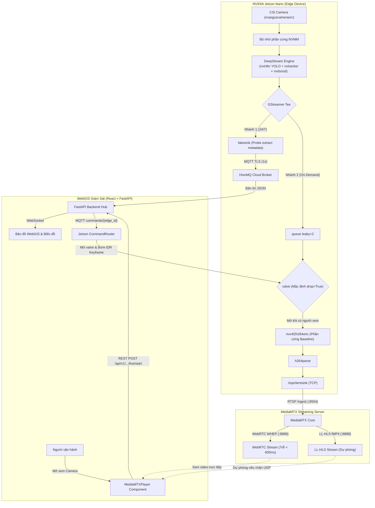

# Edge AI Traffic Monitoring & Analytics (Modular & Docker Edition)

He thong giam sat va phan tich giao thong bien tren nen tang **NVIDIA Jetson Nano** (JetPack 4.x / DeepStream 6.x / Python 3.6+) duoc thiet ke theo **Kien truc Module Hoa chuan muc**, san sang trien khai thuc dia bang Docker voi cac script dieu khien `.sh` va co che **tu khoi dong khi cap dien**.

---

## 🏛️ Cấu Trúc Dự Án (Monorepo Chuẩn Mực)

```text
edge-ai-web/
├── docs/                           # TÀI LIỆU KHÓA LUẬN, KIẾN TRÚC & SỰ CỐ
│   ├── KIEN_TRUC_HE_THONG_MICROSERVICES.md # Thuyết minh kiến trúc Microservices Polyglot
│   ├── HUONG_DAN_VIET_KHOA_LUAN_VA_TRA_LOI_HOI_DONG.md
│   ├── TONG_HOP_TOAN_BO_SU_CO_VA_LOI_HE_THONG.md
│   ├── TAI_LIEU_KIEN_TRUC_VA_CHUC_NANG_WEBGIS.md
│   ├── TAI_LIEU_KY_THUAT_CAI_TIEN_UN_TAC.md
│   ├── HUONG_PHAT_TRIEN_AI_DU_BAO_KET_XE.md
│   └── BAO_CAO_TIEN_DO_NGHIEN_CUU_EDGE_AI.md
│
├── core/                           # MODULE 1: PIPELINE & GSTREAMER
│   └── gstreamer_builder.py        # Pipeline GStreamer phần cứng (NVMM, nvargus, On-demand live stream)
│
├── spatial/                        # MODULE 2: HÌNH HỌC & KHÔNG GIAN
│   ├── geometry_utils.py           # Điểm tiếp đất bottom-center & Ray Casting đa giác ROI
│   └── roi_manager.py              # Nạp, lưu và chuẩn hóa tọa độ ROI JSON
│
├── analytics/                      # MODULE 3: PHÂN TÍCH GIAO THÔNG LÕI
│   ├── presence_counter.py         # Đếm lưu lượng theo vùng hiện diện (Hysteresis lọc nhiễu rung)
│   ├── speed_estimator.py          # Đo tốc độ thực tế qua Homography và Hồi quy tuyến tính
│   ├── traffic_classifier.py       # Phân loại trạng thái (FREE/SLOW/CONGESTED) v1
│   └── traffic_classifier_v2.py    # Thuật toán v2 cải tiến chống nhầm lẫn đèn đỏ (Dwell-time Context)
│
├── snap/                           # MODULE 4: CHỤP ẢNH BẰNG CHỨNG & NGOẠI TUYẾN
│   ├── trigger_guard.py            # Kích hoạt kép (xác nhận ùn tắc + cooldown chống spam)
│   ├── snapshot_service.py         # Điều phối chụp ảnh bằng chứng tự động & theo yêu cầu
│   ├── outbox.py                   # Hàng đợi đĩa (Disk Outbox) tự động retry khi mất mạng
│   └── runtime.py                  # Khởi tạo runtime snapshot từ biến môi trường
│
├── communication/                  # MODULE 5: TRUYỀN THÔNG & ĐIỀU KHIỂN TỪ XA
│   ├── mqtt_client.py              # MQTT Publisher: Telemetry (1s) & Heartbeat (5s) có LWT
│   ├── command_router.py           # Tiếp nhận lệnh WebGIS theo Strict Whitelist an toàn
│   └── system_metrics.py           # Giám sát % CPU, % GPU, % RAM và Nhiệt độ SoC Jetson
│
├── config/                         # MODULE 6: CẤU HÌNH TẬP TRUNG
│   └── settings.py                 # Nạp biến môi trường (.env) và định nghĩa hằng số hệ thống
│
├── configs/                        # Cấu hình DeepStream / YOLO / ROI thực địa
│   ├── config_infer_yolo11_nano.txt # Cấu hình nvinfer YOLOv11 TensorRT
│   ├── config_tracker_optimized.yml # Cấu hình DeepStream NvTracker tối ưu
│   ├── labels_custom.txt           # Nhãn phân loại phương tiện
│   └── roi_traffic_nano.json       # Tọa độ ROI và kích thước đường thực tế
│
├── webgis/                         # HỆ THỐNG GIÁM SÁT TRUNG TÂM (WEBGIS & HUB)
│   ├── backend/                    # FastAPI Realtime Hub, SQLite History & WebSocket Manager
│   ├── frontend/                   # React + TypeScript + Leaflet GIS Dashboard
│   └── auth-service/               # Node.js + Prisma + SQLite IAM Service
│
├── deploy/mediamtx/                # Máy chủ Streaming MediaMTX (WebRTC/RTSP/HLS)
├── tools/                          # Bộ công cụ kiểm thử, giả lập và đóng gói triển khai
│   ├── package_deployments.py      # Script đóng gói triển khai sạch (Jetson / WebGIS / Full)
│   ├── simulate_edge.py            # Trình giả lập đa thiết bị Edge cho WebGIS
│   └── roi_picker.py               # Công cụ trực quan vẽ đa giác ROI bằng chuột
│
├── main.py                         # Điểm điều phối trung tâm thiết bị biên (Edge Orchestrator)
├── restart_edge.sh                 # Script khởi động an toàn trên Jetson Nano
├── start_webgis_dev.bat            # Khởi chạy toàn bộ hệ thống WebGIS (Môi trường Dev)
├── start_webgis_prod.bat           # Khởi chạy toàn bộ hệ thống WebGIS (Môi trường Production)
└── tests/                          # Bộ kiểm thử tự động toàn diện (139/139 tests passed)
```

---

## 🚀 HUONG DAN VAN HANH BANG DOCKER & SCRIPT `.sh`

### 1. Cau hinh bien moi truong
Chinh sua file `.env` theo dia chi IP Backend va thong tin MQTT cua ban:
```bash
nano .env
```

### 2. Khoi chay he thong bang file `run.sh`
Chi can chay script:
```bash
chmod +x *.sh
./run.sh
```
*Script se tu dong:*
- Kiem tra va khoi dong driver camera `nvargus-daemon`.
- Tao thu muc luu anh ngoai tuyen `outbox/`.
- Chay container ngam voi day du co `--runtime nvidia`, truy cap camera CSI va mount thu muc `configs/` ngoai host.

### 3. Xem log thoi gian thuc
```bash
./view_log.sh
```

### 4. Dung he thong
```bash
./stop.sh
```

---

## 🔌 CAU HINH TU DONG CHAY KHI JETSON BAT NGUON

De khi cam nguon dien ngoai hien truong, Jetson Nano se **tu dong chay Docker container**:

```bash
# 1. Sao chep file service vao thu muc he thong
sudo cp edge-traffic-docker.service /etc/systemd/system/

# 2. Tai lai daemon va kich hoat tu khoi dong
sudo systemctl daemon-reload
sudo systemctl enable edge-traffic-docker.service

# 3. Khoi chay thu nghiem ngay lap tuc
sudo systemctl start edge-traffic-docker.service
```

*Co che:* Service nay dam bao mang Internet va driver camera CSI (`nvargus-daemon`) da san sang 100% truoc khi kich hoat Docker container, tranh hoan toan loi khong nhan dien duoc camera khi may vua khoi dong.

---

## 📡 KIẾN TRÚC LIVE STREAM ON-DEMAND QUA MEDIAMTX (CHUẨN ĐỒ ÁN AIoT)

Hệ thống cho phép **vừa chạy AI phân tích lưu lượng ngầm 24/7** bằng DeepStream, **vừa truyền luồng video trực tiếp có bounding box AI** về WebGIS theo yêu cầu (On-Demand), đảm bảo không lãng phí băng thông và giữ CPU Jetson ở mức tối thiểu.



### Bảng cổng dịch vụ Live Streaming

| Cổng | Giao thức | Vai trò trong hệ thống |
| :---: | :---: | :--- |
| **8554** | RTSP (TCP) | Jetson Nano đẩy video H.264 phần cứng lên MediaMTX (`rtspclientsink`) |
| **8888** | HTTP (LL-HLS) | Cung cấp luồng phát HLS phân đoạn fMP4 cho trình duyệt (Fallback) |
| **8889** | HTTP (WebRTC/WHEP) | Cung cấp luồng WebRTC thời gian thực (Độ trễ < 450ms) cho WebGIS |
| **8189** | UDP (WebRTC ICE) | Bắt tay kết nối mạng truyền gói tin video WebRTC qua mạng nội bộ / Internet |

### Hướng dẫn kiểm thử & Tài liệu liên quan:
- **Hướng dẫn đo đạc độ trễ & tài nguyên Jetson (`tegrastats`):** [tools/measure_live.md](tools/measure_live.md)
- **Lệnh test luồng GStreamer độc lập CLI:** [tools/live_smoke_test.md](tools/live_smoke_test.md)
- **Cấu hình MediaMTX Docker & Binary:** [deploy/mediamtx/README.md](deploy/mediamtx/README.md)

---

## 🧪 CHẠY KIỂM THỬ UNIT TEST & AUDIT TOÀN DIỆN
```bash
python -m pytest
```
*Kết quả:* **139 / 139 test cases PASSED** (Bao gồm đầy đủ các đợt hoàn thiện Đợt 0 $\rightarrow$ Đợt 8: `test_a1_a6_algorithm_audits`, `test_analytics`, `test_command_router_live`, `test_communication`, `test_concurrency_datastore`, `test_d1_d3_history_snapshots`, `test_d4_d8_performance_resilience`, `test_f1_f3_webgis_interface`, `test_live_stream_controller`, `test_modules`, `test_presence_counter`, `test_s1_s8_security_hardening`, `test_traffic_classifier_v2`).

