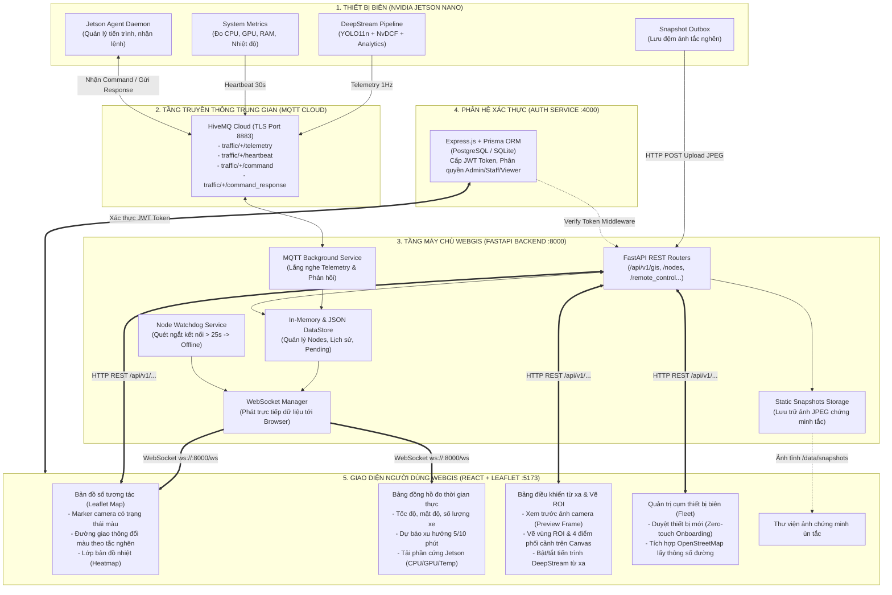
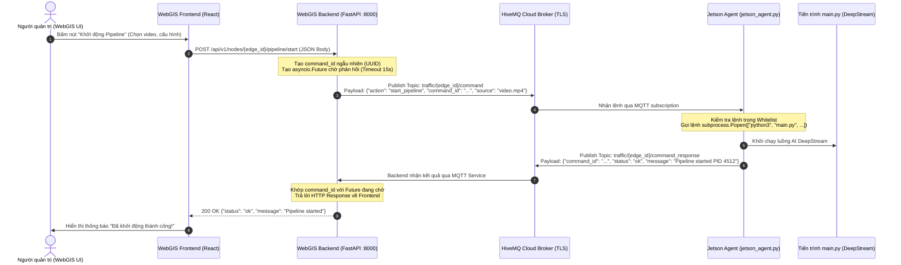
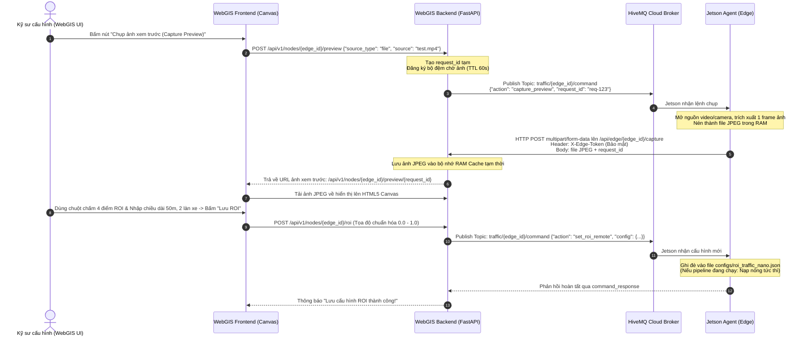

# TÀI LIỆU THIẾT KẾ KIẾN TRÚC & CHI TIẾT CHỨC NĂNG HỆ THỐNG WEBGIS
**TRUNG TÂM ĐIỀU HÀNH & GIÁM SÁT GIAO THÔNG THÔNG MINH (SMART TRAFFIC OPERATIONS CENTER)**

---

## 1. Tổng quan kiến trúc hệ thống WebGIS

Hệ thống WebGIS được xây dựng theo kiến trúc **phân tán hiện đại (Decoupled Distributed Architecture)**, kết nối trực tiếp với các thiết bị biên AI (NVIDIA Jetson Nano) thông qua mô hình truyền thông đa kênh (**MQTT + WebSocket + REST API + HTTP Upload**).

### Sơ đồ luồng tương tác tổng thể giữa WebGIS và Jetson Nano

---

## 2. Danh mục tổng hợp các chức năng hiện có của WebGIS

| STT | Tên chức năng | Phân hệ phụ trách | Giao thức / Công nghệ | Vị trí mã nguồn chính | Trạng thái |
| :---: | :--- | :--- | :--- | :--- | :--- |
| **1** | **Bản đồ giao thông số tương tác** | Frontend `Map/` | Leaflet, React, OpenStreetMap Tiles | `frontend/src/components/Map/WebGISMap.tsx` | Đã hoàn thiện |
| **2** | **Cập nhật trạng thái trực tiếp (Realtime Telemetry)** | Backend & Frontend | MQTT $\to$ WebSocket $\to$ React State | `backend/services/websocket_manager.py` | Đã hoàn thiện |
| **3** | **Đổi màu đoạn đường theo cấp độ kẹt xe** | GIS Service | GeoJSON Polyline, CSS Styling | `frontend/src/components/Map/TrafficSegmentLayer.tsx` | Đã hoàn thiện |
| **4** | **Lớp bản đồ nhiệt (Traffic Heatmap)** | GIS Service | Leaflet.heat / WebGL Canvas | `frontend/src/components/Map/HeatmapLayer.tsx` | Đã hoàn thiện |
| **5** | **Bảng điều khiển chi tiết nút giao (Node Drawer)** | Dashboard | React Lucide, Recharts | `frontend/src/components/Dashboard/NodeDashboardDrawer.tsx` | Đã hoàn thiện |
| **6** | **Giám sát tài nguyên phần cứng Jetson** | Hardware Monitor | Sysfs, Tegrastats $\to$ MQTT $\to$ UI | `backend/services/mqtt_service.py:165-210` | Đã hoàn thiện |
| **7** | **Điều khiển tiến trình từ xa (Start/Stop Pipeline)** | Remote Control | REST API $\to$ MQTT Command $\to$ Jetson | `backend/routers/remote_control.py:270-360` | Đã hoàn thiện |
| **8** | **Chụp ảnh xem trước từ xa (Capture Preview)** | Remote Control | MQTT Command $\to$ HTTP Multipart Upload | `backend/routers/remote_control.py:120-200` | Đã hoàn thiện |
| **9** | **Cấu hình vùng ROI & Hiệu chuẩn mặt đường từ xa** | Remote Control & Setup | HTML5 Canvas $\to$ MQTT $\to$ Jetson JSON | `frontend/src/components/Fleet/RemoteControlModal.tsx` | Đã hoàn thiện |
| **10** | **Quản lý danh sách video thử nghiệm trên Jetson** | Remote Control | REST API $\to$ MQTT `list_videos` $\to$ Jetson | `backend/routers/remote_control.py:85-115` | Đã hoàn thiện |
| **11** | **Tự động đăng ký thiết bị mới (Zero-touch Onboarding)** | Fleet Management | MAC Address Lookup $\to$ Pending Queue | `backend/routers/nodes.py:110-185` | Đã hoàn thiện |
| **12** | **Phê duyệt & Định vị thiết bị lên bản đồ** | Fleet Management | Modal Duyệt $\to$ Lưu DataStore $\to$ WS | `frontend/src/components/Fleet/PendingNodeApprovalModal.tsx` | Đã hoàn thiện |
| **13** | **Tích hợp OpenStreetMap lấy thông số đường** | OSM Integration | Overpass API (Truy vấn kích thước đường) | `backend/routers/osm.py:1-250` | Đã hoàn thiện |
| **14** | **Thư viện ảnh chứng minh ùn tắc (Snapshot Gallery)** | Snapshot Service | HTTP POST Multipart $\to$ Static Files | `backend/routers/snapshots.py:1-170` | Đã hoàn thiện |
| **15** | **Tự động phát hiện ngắt kết nối (Watchdog)** | Background Task | Asyncio Background Loop (25s Timeout) | `backend/main.py:40-63` | Đã hoàn thiện |
| **16** | **Xác thực và phân quyền người dùng (RBAC)** | Auth Service | JWT Token, Express, Prisma ORM | `auth-service/src/`, `backend/services/auth_middleware.py` | Đã hoàn thiện |

---

## 3. Chi tiết từng chức năng và luồng dữ liệu (Dataflow)

---

### Chức năng 1: Giám sát bản đồ số thời gian thực (Interactive WebGIS Map)

* **Mục đích:** Hiển thị trực quan toàn bộ các camera giám sát trên nền bản đồ số, thể hiện tình trạng hoạt động của camera và mức độ tắc nghẽn của từng đoạn đường.
* **Dữ liệu lấy từ đâu?**
  1. Ban đầu khi mở web: Frontend gửi yêu cầu `GET http://localhost:8000/api/v1/gis/features` để lấy danh sách toàn bộ các trạm giám sát và tọa độ các đoạn đường dưới dạng chuẩn **GeoJSON FeatureCollection**.
  2. Trong quá trình chạy: Frontend duy trì một kết nối WebSocket mở liên tục (`ws://localhost:8000/ws`). Cứ mỗi 1 giây, khi thiết bị biên gửi dữ liệu giao thông lên, máy chủ sẽ bắn gói tin `telemetry` qua WebSocket xuống trình duyệt để cập nhật trạng thái ngay lập tức mà **không cần người dùng phải bấm F5 tải lại trang**.
* **Hiển thị trên bản đồ:**
  * **Marker Camera:** Biểu tượng camera xoay theo góc hướng thực tế (`heading`) của camera ngoài thực địa. Viền marker đổi màu:
    * Xanh lá: Thiết bị đang chạy và đường thông thoáng.
    * Vàng: Dòng xe đang đi chậm.
    * Đỏ: Đang xảy ra kẹt xe.
    * Xám: Thiết bị mất tín hiệu (Offline).
  * **Đường giao thông (Traffic Polylines):** Đoạn đường gắn liền với camera tự động đổi màu tương ứng với chỉ số kẹt xe:
    * Màu xanh (#10B981): Điểm $\le 30$ (`FREE`).
    * Màu vàng (#F59E0B): Điểm $35 - 65$ (`SLOW`).
    * Màu đỏ (#EF4444): Điểm $\ge 65$ (`CONGESTED`).
  * **Lớp bản đồ nhiệt (Heatmap Layer):** Khi bật chế độ Heatmap, các điểm có mật độ xe cao sẽ phát sáng thành các quầng nhiệt vàng đỏ, giúp người vận hành nhận diện ngay các điểm nóng giao thông trong thành phố.

---

### Chức năng 2: Điều khiển tiến trình DeepStream từ xa (Remote Control C&C)

* **Mục đích:** Người quản trị tại trung tâm có thể ra lệnh cho máy Jetson Nano ngoài hiện trường **Bắt đầu chạy phân tích (`start_pipeline`)** hoặc **Dừng phân tích (`stop_pipeline`)** mà không cần phải cắm màn hình, bàn phím vào máy Nano hay SSH thủ công qua cổng mạng nội bộ.
* **Luồng dữ liệu đi đâu về đâu (Bước từng bước):**

---

### Chức năng 3: Chụp ảnh xem trước và Vẽ cấu hình ROI từ xa (Remote Preview & ROI Setup)

* **Mục đích:** Cho phép kỹ sư ngồi tại văn phòng nhìn thấy khung hình camera thực tế của Jetson Nano, dùng chuột kéo thả trực tiếp trên giao diện web để:
  * Vẽ vùng phát hiện xe (Detection ROI).
  * Vẽ vùng phân tích đo tốc độ (Analysis ROI).
  * Chấm 4 điểm hiệu chuẩn Homography thực địa và nhập kích thước đường (chiều rộng $W$, chiều dài $L$, số làn xe).
* **Luồng dữ liệu chi tiết (Đặc biệt: Kết hợp MQTT và HTTP Upload):**

---

### Chức năng 4: Tự động tiếp nhận và phê duyệt thiết bị biên (Zero-touch Fleet Onboarding)

* **Mục đích:** Khi một thiết bị Jetson Nano mới xuất xưởng được cắm điện ngoài đường, kỹ sư không cần cấu hình phức tạp:
  1. Jetson Nano tự khởi động dịch vụ và tự động đọc địa chỉ vật lý phần cứng (**MAC Address** của cổng mạng `eth0` hoặc card WiFi `wlan0`).
  2. Jetson gửi gói tin đăng ký đầu tiên:
     * **Topic MQTT:** `traffic/{edge_id}/telemetry`
     * **Nội dung:** `event: "device_registered"`, kèm địa chỉ MAC, tên thiết bị, phiên bản phần mềm.
  3. Máy chủ Backend kiểm tra trong cơ sở dữ liệu:
     * Nếu MAC Address này chưa từng được đăng ký $\implies$ Tự động chuyển vào **Hàng đợi chờ duyệt (`pending_nodes`)**.
  4. Trên giao diện WebGIS, một chuông thông báo màu vàng hiện lên kèm danh sách các thiết bị mới đang chờ duyệt.
  5. Người quản trị bấm nút **"Duyệt thiết bị" (Approve)**: Nhập vị trí GPS của camera (kinh độ, vĩ độ), tên đoạn đường quản lý $\to$ Thiết bị chính thức gia nhập hạm đội (`active_nodes`) và xuất hiện trên bản đồ số.

---

### Chức năng 5: Tự động điền thông số đường từ OpenStreetMap (OSM Integration)

* **Mục đích:** Giúp người vận hành không cần phải ra thực địa đo đạc thủ công chiều dài hay số làn đường:
* **Dữ liệu lấy từ đâu?**
  * Backend tích hợp router `routers/osm.py` kết nối trực tiếp với máy chủ **OpenStreetMap Overpass API**.
  * Khi người quản trị chấm một vị trí camera trên bản đồ:
    Backend gửi truy vấn tọa độ GPS `[lat, lng]` lên Overpass API trong bán kính 100m.
  * Overpass API trả về dữ liệu hình học của đoạn đường gần nhất:
    * Tên đường (ví dụ: *Đường Nguyễn Văn Cừ*).
    * Phân loại đường (đường trục chính `primary`, đường nội bộ `residential`...).
    * Số làn xe thực tế (`lanes: 4`).
    * Chiều dài ước lượng của đoạn đường ($L\text{ mét}$).
  * Hệ thống tự động điền các thông số này vào bảng cấu hình ROI, tiết kiệm 90% thời gian thiết lập ban đầu.

---

### Chức năng 6: Bảng đồng hồ thời gian thực & Giám sát phần cứng (Node Dashboard)

* **Mục đích:** Khi người dùng click vào một camera trên bản đồ, một ngăn kéo (Drawer) bên phải màn hình trượt ra, cung cấp toàn bộ "sức khỏe" giao thông và thiết bị:
* **Các thông số hiển thị:**
  1. **Chỉ số giao thông:**
     * Vận tốc trung bình và vận tốc trung vị ($v_{\text{avg}}, v_{\text{median}}$).
     * Mật độ chiếm dụng quy đổi xe con ($K_{\text{PCE}}$).
     * Số lượng xe hiện diện trong ROI và cơ cấu lớp (bao nhiêu xe máy, ô tô, xe tải).
     * Tỷ lệ xe dừng bánh (%).
     * Điểm số kẹt xe ($0 - 100$) và nhãn trạng thái (`FREE`, `SLOW`, `CONGESTED`).
     * Biểu đồ ngoại suy xu hướng 5 phút và 10 phút tiếp theo.
  2. **Chỉ số tài nguyên phần cứng Jetson Nano:**
     * Mức chiếm dụng GPU (%) và 4 lõi CPU (%).
     * Dung lượng RAM tiêu thụ và mức dùng bộ nhớ ảo Swap (MB).
     * Nhiệt độ chip xử lý Tegra (°C).
* **Nguồn gốc dữ liệu:** File `communication/system_metrics.py` trên Jetson Nano đọc trực tiếp từ nhân Linux hệ thống qua các đường dẫn ảo `/sys/devices/virtual/thermal/` và công cụ `tegrastats`, đóng gói thành bản tin `heartbeat` định kỳ 30 giây gửi qua MQTT lên Backend, sau đó Backend chuyển tiếp qua WebSocket tới màn hình người dùng.

---

### Chức năng 7: Thư viện ảnh chứng minh ùn tắc (Congestion Snapshot Gallery)

* **Mục đích:** Khi kẹt xe xảy ra, hệ thống không chỉ báo cáo con số khô khan mà còn tự động lưu lại **bằng chứng hình ảnh trực quan** để cơ quan quản lý giao thông đối chiếu:
* **Luồng hoạt động:**
  1. Khi trạng thái `CONGESTED` kéo dài liên tục $\ge 15\text{ giây}$ trên thiết bị biên:
     Hàm `SnapshotCoordinator` trên Jetson Nano sẽ chụp lại khung hình camera có vẽ đè thông tin OSD (điểm số, thời gian, số xe).
  2. Jetson gửi file ảnh JPEG qua giao thức **HTTP POST** lên endpoint Backend:
     `POST http://localhost:8000/api/v1/snapshots`
  3. Backend lưu file ảnh an toàn vào thư mục đĩa cứng `backend/data/snapshots/` và ghi nhận một bản ghi siêu dữ liệu (thời gian chụp, vị trí camera, điểm kẹt xe, số lượng xe).
  4. Đồng thời, Backend phát một thông báo WebSocket tới WebGIS: Trình duyệt người dùng lập tức hiển thị một popup cảnh báo đỏ góc màn hình.
  5. Người dùng có thể bấm vào mục **"Thư viện bằng chứng ùn tắc" (Snapshot Gallery)** để xem lại ảnh phóng to, tải ảnh về hoặc lọc ảnh theo thời gian và từng nút giao.

---

### Chức năng 8: Cơ chế Watchdog chống treo & Tự động phát hiện Offline

* **Mục đích:** Nếu thiết bị ngoài thực địa bị đứt dây mạng, mất nguồn điện hoặc bị tắt đột ngột, trên bản đồ không được phép tiếp tục hiển thị trạng thái cũ mà phải báo ngay cho người vận hành biết camera đã "chết".
* **Cách hoạt động:**
  1. Trong file `backend/main.py`, hàm bất đồng bộ `sweep_offline_nodes()` chạy nền liên tục với chu kỳ quét mỗi **10 giây một lần**.
  2. Hàm này kiểm tra mốc thời gian nhận dữ liệu cuối cùng (`last_seen`) của từng thiết bị trong `DataStore`.
  3. Nếu quá **25 giây** mà không nhận được bất kỳ bản tin nào (không có cả `telemetry` lẫn `heartbeat`):
     * Backend lập tức đổi trạng thái của node đó sang **`offline`**.
     * Phát một gói tin WebSocket xuống toàn bộ các trình duyệt WebGIS:
       `{"type": "heartbeat", "edge_id": "edge-01", "status": "offline"}`
     * Biểu tượng camera trên bản đồ lập tức đổi sang **màu xám** và đoạn đường tương ứng chuyển về màu trung tính.

---

## 4. Bảng tổng hợp các kênh truyền thông và giao thức kỹ thuật

| Kênh truyền thông | Điểm bắt đầu (Source) | Điểm kết thúc (Destination) | Giao thức / Port | Mục đích sử dụng |
| :--- | :--- | :--- | :--- | :--- |
| **MQTT Telemetry** | Jetson Nano (`main.py`) | WebGIS Backend | MQTT over TLS (Port 8883) | Đẩy số liệu giao thông mỗi 1 giây (`traffic/{id}/telemetry`) |
| **MQTT Heartbeat** | Jetson Nano (`system_metrics.py`) | WebGIS Backend | MQTT over TLS (Port 8883) | Báo cáo tài nguyên phần cứng mỗi 30 giây (`traffic/{id}/heartbeat`) |
| **MQTT Command** | WebGIS Backend | Jetson Nano (`jetson_agent.py`) | MQTT over TLS (Port 8883) | Gửi lệnh điều khiển từ xa: start, stop, set_roi, list_videos |
| **WebSocket Stream** | WebGIS Backend | Trình duyệt WebGIS Frontend | WebSocket (`ws://:8000/ws`) | Truyền trực tiếp dữ liệu thời gian thực không độ trễ lên giao diện |
| **HTTP REST API** | WebGIS Frontend | WebGIS Backend | HTTP JSON (Port 8000) | Tải GeoJSON bản đồ, truy vấn lịch sử, gửi lệnh điều khiển |
| **HTTP Multipart** | Jetson Nano | WebGIS Backend | HTTP POST Multipart | Tải ảnh chụp preview và ảnh chứng minh kẹt xe JPEG lên máy chủ |
| **JWT Auth** | WebGIS Frontend | Auth Service (Node.js) | HTTP JSON (Port 4000) | Đăng nhập tài khoản, xác thực quyền Admin / Vận hành viên |
