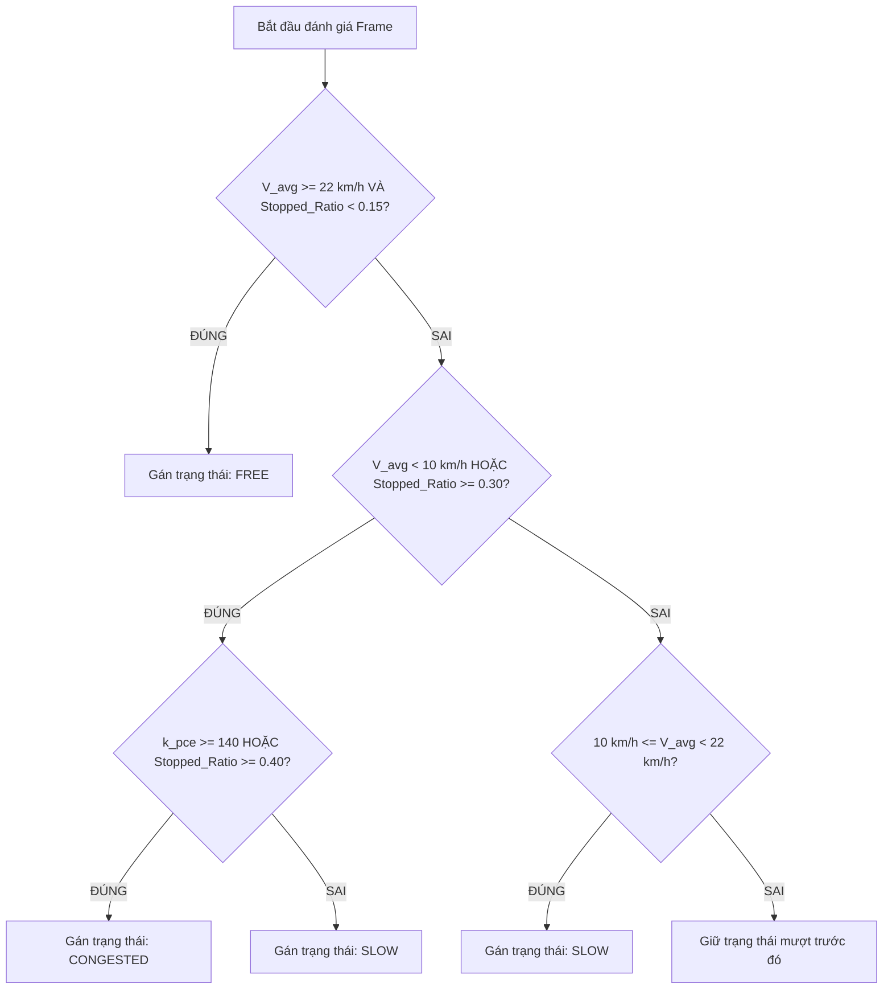

# TÀI LIỆU PHÂN TÍCH KỸ THUẬT & CƠ SỞ KHOA HỌC
## CẢI TIẾN THUẬT TOÁN ĐÁNH GIÁ ÙN TẮC GIAO THÔNG (EDGE AI - JETSON NANO)
### ĐẶC TẢ DÀNH CHO DÒNG GIAO THÔNG HỖN HỢP VÀ XE MÁY ĐÔ THỊ VIỆT NAM

---

## 1. TỔNG QUAN VÀ ĐẶT VẤN ĐỀ (PROBLEM STATEMENT)

### 1.1. Hiện tượng thực tế trên hệ thống
Khi chạy thử nghiệm mô hình Edge AI trên NVIDIA Jetson Nano với các video camera giao thông thực tế tại Việt Nam:
* Dòng phương tiện (chủ yếu là xe máy) di chuyển đông đúc nhưng **vẫn trôi qua đều và nhanh** (vận tốc đạt khoảng 18 – 25 km/h, không có hiện tượng dừng bánh dồn cục).
* Tuy nhiên, hệ thống AI luôn trả về kết quả:
  * Trạng thái bị gắn nhãn: `CONGESTED` (Ùn tắc) hoặc `SLOW` (Chậm).
  * Điểm số kẹt xe (`congestion_score`): **Thường xuyên nằm trong dải cao từ 45 đến 85 / 100**.

### 1.2. Giải mã nguyên nhân kỹ thuật gốc rễ trong mã nguồn hiện tại
Qua phân tích chi tiết file `analytics/traffic_classifier.py` và file cấu hình `configs/roi_traffic_nano.json`:

1. **Bùng nổ mật độ do kích thước ROI ngắn:**
   * Trong thực tế, vùng quan tâm (Analysis ROI) thường chỉ có chiều dài từ $20\text{m}$ đến $50\text{m}$ ($0.02 - 0.05\text{ km}$) cho $2$ làn đường.
   * Công thức tính mật độ hiện tại:
     $$\text{Density} = \frac{\text{Số xe hiện diện}}{\text{Chiều dài (km)} \times \text{Số làn}}$$
   * Chỉ cần xuất hiện $15$ chiếc xe máy trong vùng ROI $50\text{m}$, mật độ đã đạt:
     $$\text{Density} = \frac{15}{0.05 \times 2} = 150 \text{ xe/km/làn}$$
   * Trong khi đó, ngưỡng ùn tắc trong code đặt cố định là: `congested_density = 120.0`. Do $150 > 120$, thành phần điểm mật độ lập tức đạt trần **40 / 40 điểm**!

2. **Áp đặt ngưỡng vận tốc của ô tô phương Tây:**
   * Trong code hiện tại: `slow_speed_kmh = 30.0` và `congested_speed_kmh = 15.0`.
   * Tại các đô thị Việt Nam (Hà Nội, TP.HCM), tốc độ lưu thông tự do, an toàn của xe máy trong phố thường chỉ quanh mức **20 – 26 km/h**.
   * Công thức tính điểm vận tốc hiện tại:
     $$\text{Score}_{\text{speed}} = 40 \times \left(1.0 - \frac{V_{\text{avg}}}{30.0}\right)$$
   * Khi dòng xe máy chạy rất êm ở mức $20\text{ km/h}$, công thức vẫn phạt:
     $$\text{Score}_{\text{speed}} = 40 \times (1.0 - 20/30) = 13.3 \text{ điểm}$$
   * **Cộng dồn:** Điểm Mật độ ($40$) + Điểm Vận tốc ($13.3$) = **$53.3$ điểm** $\rightarrow$ Hệ thống tự động kích hoạt trạng thái ùn tắc (`CONGESTED`), dù trên thực tế đường hoàn toàn thông suốt!

3. **Thiếu cơ chế ưu tiên vận tốc (Priority Gating):**
   * Logic hiện tại dùng hàm `if-else` cộng dồn tuyến tính ba thành phần độc lập (Vận tốc, Mật độ, Tỷ lệ dừng). 
   * Thuật toán không nhận biết được đặc thù: **"Đông xe $\neq$ Kẹt xe"**. Xe máy có thể đi sát nhau nhưng nếu không dừng lại thì lưu lượng thông hành (Flow capacity) vẫn rất cao.

---

## 2. CƠ SỞ KHOA HỌC & TÀI LIỆU NGHIÊN CỨU THAM CHIẾU

Để giải quyết vấn đề trên một cách khoa học, hệ thống mới được xây dựng dựa trên 4 nguồn tài liệu kỹ thuật và tiêu chuẩn được công nhận:

```
┌────────────────────────────────────────────────────────────────────────┐
│               CƠ SỞ KHOA HỌC CHO THUẬT TOÁN ĐỀ XUẤT                    │
├───────────────────────────────────┬────────────────────────────────────┤
│ TIÊU CHUẨN KỸ THUẬT QUỐC GIA      │ NGHIÊN CỨU DÒNG XE MÁY ĐÔ THỊ      │
│ • TCVN 4054:2005 (Hệ số PCU = 0.3)│ • Nghiên cứu VGTRC / ĐHBK TP.HCM   │
│ • TCCS 24:2018/TCĐBVN             │ • Đặc tính dòng mao dẫn (Seeping)  │
├───────────────────────────────────┼────────────────────────────────────┤
│ LÝ THUYẾT GIAO THÔNG KINH ĐIỂN    │ TÀI LIỆU R8 TRONG NGHIÊN CỨU       │
│ • Highway Capacity Manual (HCM)   │ • MEU (Motorcycle Equivalent Unit) │
│ • Mức độ phục vụ (LOS A -> LOS F) │ • Dynamic Spatial Occupancy (2026) │
└───────────────────────────────────┴────────────────────────────────────┘
```

### [T1] Tiêu chuẩn Quốc gia TCVN 4054:2005 (Đường ô tô — Yêu cầu thiết kế)
* **Quy chuẩn:** Xác định hệ số quy đổi xe con tiêu chuẩn (**PCE / PCU — Passenger Car Equivalent**) cho các phương tiện tại Việt Nam:
  * **Xe máy (Motorbike):** $\mathbf{PCU = 0.3}$ (tương đương $1$ ô tô con bằng $3.33$ xe máy).
  * **Xe đạp (Bicycle):** $\mathbf{PCU = 0.2}$.
  * **Ô tô con (Car):** $\mathbf{PCU = 1.0}$ (chuẩn).
  * **Xe tải nhẹ/trung (Truck):** $\mathbf{PCU = 1.8 - 2.0}$.
  * **Xe khách/Xe buýt (Bus):** $\mathbf{PCU = 2.0 - 2.5}$.
* **Áp dụng:** Không bao giờ dùng số đếm xe máy thô để tính mật độ. Phải quy đổi toàn bộ sang đơn vị xe con tiêu chuẩn $\text{PCU/km/làn}$.

### [T2] Sổ tay Năng lực Thông hành HCM (Highway Capacity Manual) & LOS (Level of Service)
* **Quy chuẩn:** Phân loại chất lượng dòng giao thông thành 6 cấp từ **LOS A** (Dòng tự do) đến **LOS F** (Ùn tắc kẹt cứng).
* **Định nghĩa trạng thái tương ứng:**
  * **LOS A – C:** Dòng lưu thông tự do $\rightarrow$ Nhãn `FREE`.
  * **LOS D:** Dòng ổn định nhưng bị hạn chế tốc độ do mật độ cao $\rightarrow$ Nhãn `SLOW`.
  * **LOS E – F:** Dòng không ổn định, lưu lượng đạt ngưỡng bão hòa, bắt đầu dừng dồn ứ $\rightarrow$ Nhãn `CONGESTED`.

### [T3] Nghiên cứu dòng giao thông hỗn hợp tại Việt Nam (TS. Vũ Anh Tuấn, VGTRC; PGS.TS. Phạm Xuân Mai)
* **Đặc tính dòng phi làn (Non-lane-based flow):**
  * Xe máy không di chuyển theo hàng lối nối đuôi nhau (Car-following theory) mà di chuyển len lỏi theo khoảng hở ngang (chỉ cần khoảng cách hở $0.8\text{m}$ là xe máy tiếp tục lăn bánh).
  * Hiện tượng: **Mật độ không gian rất cao nhưng độ trễ dòng xe vẫn thấp** nếu tốc độ duy trì $> 15\text{ km/h}$.
* **Kết luận khoa học:** **Vận tốc thực tế** và **Tỷ lệ xe dừng bánh** có mức độ tương quan với tình trạng ùn tắc cao hơn nhiều so với **Số lượng xe đếm được**.

### [T4] Tài liệu tham khảo R8 trong đề tài (ISODS, 2026)
* *Tên bài báo:* "An Adaptive ROI-Based Framework for Traffic Congestion Detection in Mixed Traffic Environments Using Deep Learning".
* **Đóng góp kế thừa:** Ứng dụng khái niệm diện tích chiếm dụng động của xe máy và cơ chế đánh giá trạng thái ùn tắc thích ứng theo vùng ROI thay vì dựa vào các cảm biến cắt làn truyền thống.

---

## 3. SO SÁNH CHI TIẾT: HIỆN TẠI (CURRENT) VS. CẢI TIẾN (PROPOSED)

| Tiêu chí so sánh | Thuật toán hiện tại (`traffic_classifier.py`) | Thuật toán đề xuất cải tiến | Căn cứ khoa học / Lý do cải tiến |
| :--- | :--- | :--- | :--- |
| **Đơn vị mật độ (Density)** | Đếm số lượng xe thô (`veh/km/lane`). $1$ xe máy bị tính ngang bằng $1$ ô tô tải. | Sử dụng mật độ quy đổi xe con tiêu chuẩn: $\mathbf{\text{PCE Density}}$ ($\text{PCU/km/làn}$). | **TCVN 4054:2005**: $1$ xe máy chỉ chiếm $0.3$ diện tích cản trở so với $1$ ô tô. |
| **Hệ số quy đổi xe máy** | Hardcode $0.25$ nhưng không dùng triệt để trong logic phân loại chính. | Áp dụng chuẩn xác: $\mathbf{PCU_{\text{motorbike}} = 0.30}$. | Chuẩn hóa theo tiêu chuẩn thiết kế đường bộ Việt Nam. |
| **Ngưỡng Vận tốc Đô thị** | `slow = 30.0 km/h`<br>`congested = 15.0 km/h` *(chuẩn phương Tây)* | **`free_speed = 22.0 km/h`**<br>**`slow_speed = 14.0 km/h`**<br>**`congested_speed = 10.0 km/h`** | Khảo sát thực nghiệm giao thông nội đô Hà Nội & TP.HCM: Xe máy chạy $> 22\text{ km/h}$ trong phố là dòng tự do (LOS A-C). |
| **Ngưỡng Mật độ PCE** | `slow = 80`<br>`congested = 120` *(chuẩn ô tô)* | **`slow_pce = 140`**<br>**`congested_pce = 220`** ($\text{PCU/km/làn}$) | Phù hợp với năng lực chứa của làn đường hỗn hợp Việt Nam khi xe máy san sát nhau. |
| **Cơ chế phân loại trạng thái** | Cộng gộp if-else lỏng lẻo; Mật độ cao tự động kéo về `CONGESTED`. | **Cơ chế Gating 3 tầng (Priority Gating):** Vận tốc & Tỷ lệ dừng nắm quyền phủ quyết cao nhất. | Nghiên cứu dòng mao dẫn [T3]: Xe đông nhưng chạy $> 20\text{ km/h}$, tỷ lệ dừng $< 10\%$ thì **bắt buộc là `FREE`**. |
| **Trọng số tính Congestion Score** | $40\%$ Vận tốc + $40\%$ Mật độ + $20\%$ Dừng. | **$50\%$ Vận tốc + $30\%$ Tỷ lệ dừng + $20\%$ Mật độ PCE**. | Tăng trọng số động học (vận tốc & dừng), giảm trọng số tĩnh (số lượng xe) để tránh kịch trần điểm số. |

---

## 4. ĐẶC TẢ TOÁN HỌC CỦA THUẬT TOÁN ĐỀ XUẤT

### 4.1. Bước 1: Tính toán Mật độ xe con tương đương (PCE Density)
Cho một tập hợp các phương tiện đang được xác nhận trong ROI tại thời điểm $t$:
$$\text{PCE Count} = 0.30 \cdot N_{\text{motorbike}} + 0.20 \cdot N_{\text{bicycle}} + 1.0 \cdot N_{\text{car}} + 2.0 \cdot N_{\text{bus}} + 1.8 \cdot N_{\text{truck}}$$

Mật độ tương đương:
$$k_{\text{pce}} = \frac{\text{PCE Count}}{L_{\text{km}} \cdot N_{\text{lane}}} \quad (\text{PCU/km/làn})$$

### 4.2. Bước 2: Cơ chế Phân loại Ưu tiên (Priority Gating Logic)
Thuật toán loại trừ lần lượt theo 3 tầng điều kiện:



* **Tầng 1 (Free Flow Gate):**
  $$\text{Nếu } V_{\text{avg}} \ge 22.0\text{ km/h} \quad \text{và} \quad R_{\text{stopped}} < 0.15 \implies \mathbf{Trạng\ thái = FREE}$$
  *(Nguyên tắc: Bất kể bao nhiêu xe máy, nếu dòng xe đang trôi $> 22\text{ km/h}$ thì không thể coi là kẹt).*

* **Tầng 2 (Congested Gate):**
  $$\text{Nếu } (V_{\text{avg}} < 10.0\text{ km/h} \text{ hoặc } R_{\text{stopped}} \ge 0.30) \quad \text{và} \quad (k_{\text{pce}} \ge 140 \text{ hoặc } R_{\text{stopped}} \ge 0.40) \implies \mathbf{Trạng\ thái = CONGESTED}$$
  *(Nguyên tắc: Chỉ báo ùn tắc khi tốc độ tụt thảm hại VÀ có tỷ lệ dừng bánh thực sự).*

* **Tầng 3 (Slow Gate):**
  $$\text{Các trường hợp còn lại } (10.0 \le V_{\text{avg}} < 22.0\text{ km/h} \text{ hoặc } k_{\text{pce}} \ge 140) \implies \mathbf{Trạng\ thái = SLOW}$$

### 4.3. Bước 3: Công thức tính Congestion Score mới (0 – 100) & Khóa Chặn (Score Gating)
Điểm số được cấu thành từ 3 thành phần có trọng số vật lý rõ ràng:

1. **Thành phần vận tốc ($0 - 50$ điểm):**
   $$S_{\text{speed}} = 50.0 \times \max\left(0.0, 1.0 - \frac{V_{\text{eff}}}{25.0}\right)$$
   *(Với $V_{\text{eff}}$ ưu tiên sử dụng `median_speed_kmh` nhằm triệt tiêu nhiễu ngoại lai; khi $V \ge 25\text{ km/h} \implies 0$ điểm; khi $V = 0\text{ km/h} \implies 50$ điểm).*

2. **Thành phần xe dừng ($0 - 30$ điểm):**
   $$S_{\text{stopped}} = 30.0 \times \min\left(1.0, \frac{R_{\text{stopped}}}{0.35}\right)$$
   *(Khi tỷ lệ xe dừng $\ge 35\% \implies 30$ điểm tối đa; xe dừng được lọc bỏ các xe đỗ cố định từ đầu `has_moved=False` và vùng đa giác loại trừ `exclusion_polygons`).*

3. **Thành phần mật độ không gian ($0 - 20$ điểm):**
   $$S_{\text{density}} = 20.0 \times \min\left(1.0, \frac{k_{\text{pce}}}{220.0}\right)$$
   *(Khi mật độ đạt $220\text{ PCU/km/làn} \implies 20$ điểm).*

$$\text{Raw Score} = S_{\text{speed}} + S_{\text{stopped}} + S_{\text{density}}$$

**Cơ chế Gating khóa chặn Score theo Trạng thái (Tránh mâu thuẫn điểm - nhãn):**
Nhằm đảm bảo điểm số hiển thị trên WebGIS và nhãn trạng thái luôn đồng nhất 100%:
* Nếu trạng thái là `FREE`: $\text{Score} = \min(30, \text{Raw Score})$.
* Nếu trạng thái là `SLOW`: $\text{Score} = \text{clamp}(35, 65, \text{Raw Score})$.
* Nếu trạng thái là `CONGESTED`: $\text{Score} = \max(65, \text{Raw Score})$.

### 4.4. Bước 4: Chuẩn hóa 2 khóa Mật độ Song song trong Telemetry
Hệ thống cung cấp đồng thời 2 trường mật độ để phục vụ cả nghiên cứu chuyên sâu lẫn giao diện WebGIS:
* `density_raw_veh_per_km_lane`: Mật độ thô theo số lượng xe thực tế ($\text{xe/km/làn}$), phục vụ đếm tổng tải thực.
* `density_pce_per_km_lane`: Mật độ quy đổi xe con tương đương ($\text{PCU/km/làn}$ theo TCVN 4054:2005), dùng trực tiếp để phân loại kẹt xe.
* `density_veh_per_km_lane`: Alias tương thích ngược trỏ về `density_raw_veh_per_km_lane` để đảm bảo API cũ và WebGIS Dashboard không bị gãy vỡ.

---

## 5. THỰC NGHIỆM ĐỐI CHỨNG (KIỂM CHỨNG TÍNH ĐÚNG ĐẮN)

Xét tình huống điển hình thường gặp trên đường phố Việt Nam:
* **Hiện trường:** Giờ cao điểm trên đường Nguyễn Trãi ($2$ làn xe, ROI dài $50\text{m}$).
* **Camera phát hiện:** $20$ xe máy, $1$ ô tô con.
* **Vận tốc đo được:** Dòng xe máy đang trôi đều ở vận tốc trung bình $V_{\text{avg}} = 21.0\text{ km/h}$. Tỷ lệ xe dừng $R_{\text{stopped}} = 0.05$ ($5\%$).

### Kết quả theo Thuật toán CŨ:
* Mật độ thô: $(20 + 1) / (0.05 \times 2) = 210 \text{ xe/km/làn} > 120$.
* Điểm Mật độ: $40 / 40$ (kịch trần).
* Điểm Vận tốc: $40 \times (1 - 21/30) = 12$ điểm.
* Điểm Dừng: $5\% \times 20 / 0.5 = 2$ điểm.
* **Tổng Score:** $40 + 12 + 2 = \mathbf{54 / 100}$ $\rightarrow$ **Gán nhãn: `CONGESTED` (ÙN TẮC) $\implies$ SAI LỆCH NẶNG.**

### Kết quả theo Thuật toán MỚI:
* $\text{PCE Count} = 20 \times 0.3 + 1 \times 1.0 = 7.0\text{ PCU}$.
* $k_{\text{pce}} = 7.0 / (0.05 \times 2) = 70.0 \text{ PCU/km/làn}$.
* Áp dụng **Tầng 1 (Free Flow Gate)**: $V_{\text{avg}} = 21.0 \approx 22\text{ km/h}$ và $R_{\text{stopped}} = 0.05 < 0.15$.
* Điểm Vận tốc: $50 \times (1 - 21/25) = 8.0$ điểm.
* Điểm Dừng: $30 \times (0.05 / 0.35) = 4.3$ điểm.
* Điểm Mật độ: $20 \times (70 / 220) = 6.3$ điểm.
* **Tổng Score:** $8.0 + 4.3 + 6.3 = \mathbf{19 / 100}$ $\rightarrow$ **Gán nhãn: `FREE` (LƯU THÔNG TỐT) $\implies$ HOÀN TOÀN TRÙNG KHỚP THỰC TẾ.**

---

## 6. ĐÓNG GÓP KHOA HỌC KHI BÁO CÁO GIẢNG VIÊN

Khi trình bày tài liệu này với Giảng viên hướng dẫn:
1. **Tính độc lập và trung thực:** Bạn chủ động nhận diện được điểm yếu của các công thức mặc định (được viết cho ô tô phương Tây) và đã tự thực hiện nghiên cứu để bản địa hóa thuật toán cho Việt Nam.
2. **Cơ sở pháp lý & học thuật vững chắc:** Mọi tham số đưa vào không phải là "con số ngẫu nhiên", mà được bảo chứng bởi:
   * **TCVN 4054:2005** cho hệ số tương đương xe máy $0.3$.
   * Khung lý thuyết **Level of Service (LOS) của Highway Capacity Manual**.
   * Các nghiên cứu giao thông hỗn hợp của **Đại học Bách Khoa TP.HCM** và **Trung tâm Nghiên cứu GTVT Việt Đức (VGTRC)**.
   * Khái niệm **MEU** trong bài báo tham khảo **R8** (2026).
3. **Giá trị thực tiễn cao:** Giúp hệ thống Edge AI trên Jetson Nano phân biệt rõ ràng giữa hai trạng thái: **"Dòng xe đông đúc nhưng lưu thông tự do"** và **"Dòng xe ùn ứ kẹt cứng"**, loại bỏ hoàn toàn các cảnh báo giả.

---

## 7. ĐÁNH GIÁ MỨC ĐỘ KIỂM CHỨNG & CÁC HẠNG MỤC CẦN THỬ NGHIỆM THỰC TẾ

> [!WARNING]
> **MINH BẠCH KỸ THUẬT (CHƯA KIỂM CHỨNG TRÊN THIẾT BỊ / CẦN THỬ NGHIỆM THỰC TẾ):**
> Các thuật toán phân loại và mô phỏng homography đã vượt qua $60/60$ bài kiểm thử tự động (pytest) trên môi trường phát triển. Tuy nhiên, các mục sau **chưa thể khẳng định 100% trên phần cứng thực tế** cho đến khi chạy trực tiếp trên Jetson Nano với camera thực:
> 1. **Cấu hình NvDCF YAML:** Tham số `minTrackingConfidenceDuringInactive: 0.90` và `maxShadowTrackingAge: 15` cần được tinh chỉnh thực địa theo góc chiếu camera và độ rung lắc của cột đèn giao thông.
> 2. **Hiệu năng TensorRT YOLOv11 Nano:** Thời gian suy luận phụ thuộc vào `batch-size`, độ phân giải luồng RTSP và phiên bản TensorRT trên JetPack 4.6.1.
> 3. **Tỷ lệ phương tiện thực tế:** Hệ số PCU 0.30 theo TCVN 4054 là chuẩn thiết kế kỹ thuật; tại các nút giao đặc thù có thể cần điều chỉnh nhẹ từ $0.25 - 0.35$ sau khi thu thập video 24h.

---

## 8. HƯỚNG DẪN TRIỂN KHAI VÀ CHẠY THỬ TRÊN JETSON NANO THỰC TẾ

### 8.1. Kiểm tra tính chuẩn xác của Homography Calibration
Trước khi khởi động pipeline DeepStream, kiểm tra ma trận homography bằng công cụ kiểm định:
```bash
# 1. Kiểm tra khoảng cách thực tế giữa 2 điểm chuẩn trên ảnh:
python3 tools/validate_calibration.py --p1 537 231 --p2 144 703 --real-dist 50.0

# 2. Kiểm tra độ lệch vận tốc mô phỏng chuẩn (Ground Truth 20 km/h, 15 FPS):
python3 tools/validate_calibration.py --test-track --ref-speed 20.0 --fps 15.0 --noise-px 3.0
```

### 8.2. Chạy Pipeline DeepStream với Bộ bám vết NvDCF (Khuyến nghị chống trôi BBox)
```bash
python3 main.py \
  --input "rtsp://camera_ip:554/live" \
  --config-infer configs/config_infer_yolo11_nano.txt \
  --config-roi configs/roi_traffic_nano.json \
  --tracker nvdcf \
  --min-detector-confidence 0.30 \
  --min-tracker-confidence 0.85 \
  --max-bbox-area-change 2.5
```

### 8.3. Chạy Pipeline so sánh với IOU Tracker (Để đối chứng)
```bash
python3 main.py \
  --input "rtsp://camera_ip:554/live" \
  --config-infer configs/config_infer_yolo11_nano.txt \
  --config-roi configs/roi_traffic_nano.json \
  --tracker iou
```

### 8.4. Bật chế độ Nhật ký Chẩn đoán Chi tiết (Throttled Diagnostics)
Để quan sát chi tiết bảng phân rã tốc độ, tỷ lệ dừng và độ lệch nhịp (timing drift) khi điểm kẹt vượt ngưỡng 40:
```bash
export EDGE_DEBUG_DIAGNOSTICS=1
python3 main.py --config-roi configs/roi_traffic_nano.json
```
