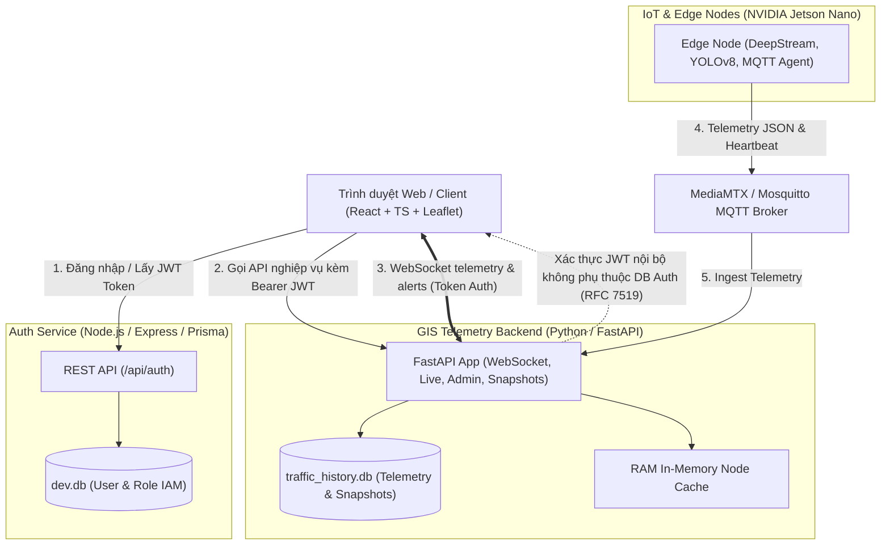

# 🏛️ KIẾN TRÚC HỆ THỐNG POLYGLOT MICROSERVICES (AUTH & GIS TELEMETRY)

Tài liệu này thuyết minh chi tiết quyết định thiết kế kiến trúc hệ thống WebGIS Traffic Monitoring (mục **C2** trong đợt chuẩn hóa hệ thống), làm cơ sở cho báo cáo khóa luận tốt nghiệp và bảo vệ trước hội đồng khoa học.

---

## 1. Tổng quan Kiến trúc

Hệ thống WebGIS được thiết kế theo mô hình **Polyglot Microservices** phân tách độc lập giữa dịch vụ danh tính người dùng (**Identity & Access Management - IAM**) và dịch vụ xử lý dữ liệu viễn thám / GIS thời gian thực (**Realtime Telemetry & GIS Hub**).

---

## 2. Lý do lựa chọn mô hình phân tách 2 Backend (Polyglot Microservices)

| Tiêu chí | Auth Service (`webgis/auth-service`) | Telemetry Backend (`webgis/backend`) |
| :--- | :--- | :--- |
| **Công nghệ** | Node.js (TypeScript) + Express + Prisma ORM | Python 3.10+ + FastAPI + Uvicorn |
| **Cơ sở dữ liệu** | SQLite (`prisma/dev.db`) | SQLite (`traffic_history.db`) + RAM Cache |
| **Nhiệm vụ cốt lõi** | Quản lý người dùng, mật khẩu, phân quyền RBAC (ADMIN, STAFF, VIEWER). | Xử lý gói tin MQTT tần số cao, streaming WebSocket, tính toán phân loại ùn tắc, quản lý camera RTSP. |
| **Tính chất tải** | Tần số thấp (Low frequency, I/O bound cho login/refresh). | Tần số cao (High throughput, real-time streaming, concurrency). |

### 2.1. Độc lập nghiệp vụ & Nguyên lý phân tách trách nhiệm (Separation of Concerns)
- **Node.js + Prisma ORM** mang lại hệ sinh thái quản lý dữ liệu người dùng chặt chẽ với schema type-safe, migration tự động và thư viện mã hóa mật khẩu an toàn (`bcryptjs`).
- **Python + FastAPI** là lựa chọn tiêu chuẩn cho hệ thống phân tích dữ liệu, AI Edge integration và hỗ trợ xử lý luồng streaming, tính toán khoa học (tương thích trực tiếp với các module xử lý thị giác máy tính và MQTT payload từ Jetson Nano).

### 2.2. Cơ chế xác thực phi trạng thái (Stateless Authorization qua JWT RFC 7519)
- Auth-service đóng vai trò **Token Issuer**: Khi người dùng đăng nhập thành công, service ký JWT chứa `userId`, `username`, `role` kèm hạn sử dụng và bí mật `JWT_SECRET`.
- FastAPI Backend đóng vai trò **Resource Server**: FastAPI giải mã và xác minh chữ ký (signature) trực tiếp trong RAM thông qua `python-jose` / `jwt` mà **không cần thực hiện network call** hoặc truy vấn ngược vào database của Auth-service.
- Nhờ cơ chế này, tốc độ xác thực của các endpoint thời gian thực (FastAPI) đạt cấp độ micro-second và không bị thắt cổ chai bởi cơ sở dữ liệu xác thực.

### 2.3. Khả năng mở rộng trong tương lai (Scalability)
- Khi số lượng người dùng truy cập bản đồ GIS tăng vọt (hàng nghìn kết nối WebSocket), cụm `webgis/backend` có thể scale ngang (horizontal scaling) độc lập mà không ảnh hưởng tới `auth-service`.
- Trong tương lai, nếu doanh nghiệp chuyển đổi sang các dịch vụ SSO tập trung như Keycloak, Okta hoặc Google OAuth2, việc thay thế `auth-service` hoàn toàn không làm thay đổi logic lõi của `webgis/backend`.

---

## 3. Quản trị & Đồng bộ Bảo mật

1. **Khóa ký JWT (`JWT_SECRET`):** Cả hai dịch vụ cùng chia sẻ chung giá trị biến môi trường `JWT_SECRET`. Trong môi trường Production, biến này được nạp qua file `.env` hoặc hệ thống quản lý Secret của máy chủ triển khai.
2. **Phân quyền RBAC:**
   - `ADMIN`: Toàn quyền quản trị hệ thống, phê duyệt thiết bị Edge, quản lý người dùng.
   - `STAFF`: Điều khiển luồng camera RTSP, điều khiển chụp ảnh kiểm tra hiện trường, nhận cảnh báo phần cứng.
   - `VIEWER` / Khách: Xem bản đồ giao thông trực quan, xem mật độ xe và lịch sử ùn tắc công cộng.

