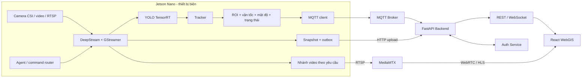

# Tài liệu mô tả hệ thống giám sát giao thông Edge AI và WebGIS

**Phiên bản:** 1.0  
**Phạm vi:** nguyên mẫu quy mô nhỏ của đồ án.  
**Đối tượng:** người có kiến thức CNTT cơ bản, chưa biết cấu trúc dự án.

> Tài liệu này mô tả mã nguồn/cấu hình hiện có. Các con số hiệu năng, độ chính xác và độ trễ chỉ được khẳng định khi có log đo kèm điều kiện tái lập. Tài liệu rà soát trong repository ghi nhận các bảng mAP, FPS/tài nguyên, sai số vận tốc còn thiếu; công cụ so sánh classifier hiện dùng kịch bản tổng hợp. Vì vậy tài liệu không trình bày số liệu mẫu hoặc kỳ vọng như kết quả thực nghiệm.

## 1. Tóm tắt

Dự án xây dựng nguyên mẫu Edge AIoT (trí tuệ nhân tạo và Internet vạn vật tại biên) kết hợp WebGIS để phân tích video giao thông gần nguồn camera. Jetson Nano chạy pipeline DeepStream/GStreamer, phát hiện và theo dõi phương tiện, tính các chỉ số giao thông trong vùng đã cấu hình, rồi gửi telemetry (dữ liệu đo và tình trạng thiết bị) qua MQTT tới backend. Giao diện WebGIS hiển thị trạng thái các node và cung cấp chức năng xem camera trực tiếp theo yêu cầu, điều khiển node và xem ảnh snapshot.

Hệ thống gồm hai miền:

1. **Thiết bị biên:** xử lý video, analytics, MQTT agent, nhận lệnh và lưu/gửi ảnh minh chứng.
2. **Trung tâm WebGIS:** Auth Service, FastAPI backend, giao diện React/TypeScript và MediaMTX để chuyển tiếp video.

Đây là nguyên mẫu để kiểm chứng tích hợp trong phạm vi nhỏ. Hệ thống không phải nền tảng điều hành giao thông diện rộng, không tự điều khiển đèn tín hiệu và không bảo đảm phân loại chính xác tuyệt đối hay giải quyết hoàn toàn ùn tắc.

## 2. Bối cảnh và yêu cầu

Video liên tục có dung lượng lớn. Đẩy mọi khung hình lên máy chủ để phân tích làm tăng phụ thuộc vào mạng và năng lực trung tâm. Jetson Nano có tài nguyên giới hạn nên cần cân bằng chất lượng phân tích với bộ nhớ, GPU, nhiệt độ và băng thông.

Đông phương tiện không đồng nghĩa với ùn tắc. Dòng xe máy hỗn hợp có hành vi khác dòng xe con; nghiên cứu tại Hà Nội và TP. Hồ Chí Minh ghi nhận hệ số tương đương xe máy phụ thuộc đặc tính vận tốc, không gian chiếm dụng và bối cảnh ([Cao & Sano, 2012](https://doi.org/10.1061/%28ASCE%29TE.1943-5436.0000382), [Nguyen & Yue, 2007](https://www.jstage.jst.go.jp/article/easts/7/0/7_0_2207/_article/-char/en)). Vì vậy dự án dùng nhiều chỉ số và giới hạn kết luận vào camera/ROI đã cấu hình.

| Yêu cầu | Cách đáp ứng | Giới hạn |
|---|---|---|
| Phân tích gần nguồn video | DeepStream/GStreamer và TensorRT trên Jetson | Hiệu năng phụ thuộc model, độ phân giải, tracker, nhiệt độ và cấu hình |
| Hạn chế truyền video liên tục | Gửi JSON telemetry qua MQTT; nhánh video mở theo yêu cầu | Live stream vẫn tiêu thụ băng thông |
| Đếm và theo dõi trong vùng | Tracker cấp track ID; ROI lọc đối tượng | Có thể mất/đổi ID khi che khuất hoặc detection yếu |
| Giám sát tập trung | Backend MQTT ingest, API/WebSocket, WebGIS | Một số cache lưu trong RAM |
| Mất mạng tạm thời | Snapshot lưu outbox và retry | Dung lượng hữu hạn; không phải mọi dữ liệu đều lưu offline |
| Điều khiển từ xa | Lệnh qua backend/MQTT và whitelist trên edge | Phụ thuộc mạng, quyền và agent đang chạy |

## 3. Phạm vi, giả định và giới hạn

- Một camera hoặc nguồn video cho mỗi cấu hình edge; nguồn có thể là CSI, file, thiết bị video hoặc RTSP tùy chế độ.
- Phân tích trong ROI (region of interest — vùng quan tâm) do người cấu hình; không phân tích hiểu biết toàn cảnh.
- Dùng detector YOLO qua cấu hình DeepStream/TensorRT và tracker. Infer config khai báo 7 nhãn; analytics có ánh xạ loại xe riêng.
- Ước lượng vận tốc trên mặt phẳng đường sau hiệu chuẩn.
- Phân loại ba trạng thái tổng quát FREE/SLOW/CONGESTED.
- Không khẳng định kết quả đại diện cho mọi tuyến, camera, thời tiết, ánh sáng hoặc thành phần xe.
- Score 0–100 không phải tiêu chuẩn giao thông pháp lý.
- Vận tốc không phải giá trị chuẩn nếu chưa đối chiếu GPS/IMU/thiết bị độc lập.
- Ngoại suy tuyến tính trên lịch sử không phải mô hình học máy được huấn luyện.
- Dữ liệu giả lập/demo không được mô tả như khảo sát hiện trường.

Khi chốt báo cáo, cần điền số node/camera, vị trí/góc nhìn, thời lượng video, ngày đo, cấu hình Jetson và tập gán nhãn. Nếu chưa có, kết luận chỉ nên ở mức mô tả nguyên mẫu và kiểm thử chức năng.

## 4. Kiến trúc tổng thể

| Thành phần | Trách nhiệm | Mã nguồn |
|---|---|---|
| Edge orchestrator | Khởi tạo pipeline, analyzer, agent, snapshot | [main.py](../main.py) |
| Pipeline builder | Source, mux, infer, tracker, OSD, nhánh live | [core/gstreamer_builder.py](../core/gstreamer_builder.py) |
| Analytics/hình học | ROI, vận tốc, mật độ, classifier | [analytics/](../analytics), [spatial/](../spatial) |
| MQTT và điều khiển | Heartbeat, telemetry, command, metrics | [communication/](../communication) |
| Snapshot/outbox | Chụp ảnh, lưu cục bộ, retry | [snap/](../snap) |
| Backend | MQTT ingest, API, WebSocket, node/history/live | [webgis/backend/](../webgis/backend) |
| Auth | Tài khoản, token, role | [webgis/auth-service/](../webgis/auth-service) |
| UI | Bản đồ, dashboard, lịch sử, live | [webgis/frontend/src/](../webgis/frontend/src) |
| Video relay | RTSP ingest và WebRTC/HLS | [deploy/mediamtx/mediamtx.yml](../deploy/mediamtx/mediamtx.yml) |

## 5. Môi trường và phiên bản

Đây là phiên bản mục tiêu/ghi trong repository, chưa đồng nghĩa runtime trên thiết bị đã được xác minh. Cần ghi lại phiên bản cài thực tế trước khi chốt luận văn.

| Khu vực | Phiên bản dự án | Lý do và đánh đổi |
|---|---|---|
| Jetson Nano | JetPack 4.6.1 / L4T 32.7.1; CUDA 10.2; TensorRT 8.2.1; cuDNN 8.2.1; DeepStream 6.0.1; Python 3.6 | Tương thích thế hệ Nano và DeepStream 6.0.1; SDK chứa driver/thư viện phần cứng cần phối hợp. Không thể nâng tùy ý vì board, OS, plugin YOLO và TensorRT có ràng buộc. Đổi lại, runtime cũ hạn chế thư viện mới. ([JetPack 4.6.1 release notes](https://docs.nvidia.com/jetson/jetpack/4.6.1/release-notes/index.html), [DeepStream 6.0.1 Quickstart](https://docs.nvidia.com/metropolis/deepstream/6.0.1/dev-guide/text/DS_Quickstart.html)) |
| Edge Python | Paho MQTT 1.6.1; các thư viện khác phần lớn có ràng buộc >= trong [requirements.txt](../requirements.txt) | Paho 1.6.1 được ghi chú trong mã là tương thích Python 3.6. Ràng buộc >= không khóa môi trường tái lập; cần lấy phiên bản thực tế từ Jetson. PyDS/GI dự kiến được cung cấp từ JetPack/DeepStream. |
| Backend | FastAPI >=0.109.0, Uvicorn >=0.27.0, Paho >=1.6.1, Pydantic >=2.5.0 và các gói khác trong [requirements.txt](../webgis/backend/requirements.txt); README nêu Python >=3.10 | FastAPI cho API bất đồng bộ/WebSocket; Uvicorn chạy ASGI. Khoảng >= tiện cài nhưng có thể làm môi trường thay đổi. |
| Frontend | React 19.2.x, TypeScript ~6.0.2, Vite 8.3.x, MapLibre GL 6.10.x, ECharts 6.1.x theo [package.json](../webgis/frontend/package.json) | Component UI, kiểm tra kiểu, dev/build nhanh, bản đồ và biểu đồ. Phiên bản cài chính xác lấy từ package-lock. |
| Auth service | Express 4.21.x, Prisma 5.22.x, SQLite, bcryptjs, JWT theo [package.json](../webgis/auth-service/package.json) | Tách xác thực; SQLite đơn giản cho nguyên mẫu và lượng tài khoản nhỏ, không hàm ý HA/tải lớn. |
| Video relay | MediaMTX binary hoặc Docker; cần xác nhận phiên bản runtime | Tách video khỏi backend nghiệp vụ; phục vụ nhiều giao thức. |

JetPack 4.6.1 được chọn theo tương thích Nano, không phải vì đó là bản mới nhất hoặc nhanh nhất. NVIDIA liệt kê L4T 32.7.1, CUDA 10.2, TensorRT 8.2.1, cuDNN 8.2.1; tài liệu DeepStream 6.0.1 hướng dẫn JetPack 4.6.1 cho Nano. Xác minh thiết bị bằng lệnh phù hợp như dpkg, nvcc, python --version, tegrastats và node --version.

### 5.1 FP16

Infer config đặt network-mode 2, tương ứng FP16 trong cấu hình TensorRT. FP16 dùng số 16-bit, có thể giảm dung lượng tính toán/trung gian và tận dụng đường thực thi được hỗ trợ. Mức lợi ích phụ thuộc GPU, model và engine; đầu ra số học cũng có thể khác FP32. Do đó lý do triển khai là cân bằng tài nguyên trên Nano; không tuyên bố nhanh gấp đôi hoặc không giảm độ chính xác khi chưa so sánh cùng model/dữ liệu/thiết bị. Tham khảo [TensorRT precision control](https://docs.nvidia.com/deeplearning/tensorrt/latest/inference-library/precision.html).

## 6. Kỹ thuật và căn cứ

### 6.1 DeepStream/GStreamer/TensorRT

GStreamer biểu diễn media processing thành các element nối tiếp hoặc phân nhánh. DeepStream bổ sung plugin NVIDIA như nvstreammux, nvinfer, nvtracker, nvdsosd. Mã dùng Python/GI để điều phối, còn plugin native thực hiện phần lớn xử lý video/inference.

Cấu hình hiện có batch-size 1, FP16, interval 1, 7 nhãn và custom YOLO parser. nvtracker duy trì ID; interval=1 bỏ qua một frame giữa hai lần inference theo CLI, giảm số lần gọi detector nhưng tăng phụ thuộc vào tracker. Vật thể nhỏ/nhanh hoặc cảnh dày có thể bị ảnh hưởng. Chỉ benchmark mới xác nhận hiệu quả. Nguồn: [DeepStream 6.0.1](https://docs.nvidia.com/metropolis/deepstream/6.0.1/dev-guide/text/DS_Quickstart.html), [nvinfer guide](https://docs.nvidia.com/metropolis/deepstream/dev-guide/text/DS_plugin_gst-nvinfer.html), [nvtracker guide](https://docs.nvidia.com/metropolis/deepstream/dev-guide/text/DS_plugin_gst-nvtracker.html).

### 6.2 ROI

ROI là kỹ thuật phổ biến để chỉ phân tích phần ảnh liên quan; không phải thuật toán do dự án phát minh. Dự án lưu detection_roi và analysis_roi dạng tọa độ chuẩn hóa. Điểm đại diện bbox được kiểm tra thuộc polygon; bộ đếm xác nhận vào/ra theo thời gian để giảm rung ở biên.

Tách hai vùng cho phép detection ROI rộng hơn vùng tính số liệu. ROI cần hiệu chỉnh cho từng góc camera; đổi vị trí/zoom cần cấu hình lại. Điểm đáy bbox chỉ xấp xỉ tiếp điểm bánh xe, nên che khuất và bbox không khít tạo sai số.

### 6.3 Vận tốc qua homography

Homography (biến đổi phối cảnh phẳng) ánh xạ mặt phẳng ảnh sang mặt phẳng đường. OpenCV cung cấp getPerspectiveTransform/findHomography và perspectiveTransform ([OpenCV geometric transforms](https://docs.opencv.org/4.10.0/da/d54/group__imgproc__transform.html), [perspectiveTransform](https://docs.opencv.org/4.10.0/d2/de8/group__core__array.html)). Bell, Xiao và James mô tả hiệu chuẩn homography mặt đường, detection/tracking và tính tốc độ từ video cố định ([ISPRS 2020](https://isprs-annals.copernicus.org/articles/V-2-2020/419/2020/isprs-annals-V-2-2020-419-2020.pdf)). Đây là căn cứ cho nguyên lý, không phải bằng chứng dự án đạt cùng sai số.

Trong mã, người dùng khai báo bốn điểm ảnh và chiều dài/rộng thực; điểm đáy giữa bbox được ánh xạ sang mét. TrackSpeedEstimator giữ tọa độ theo thời gian, hồi quy tuyến tính trong cửa sổ lịch sử, yêu cầu thời gian/chuyển vị tối thiểu, lọc mẫu ngoài giới hạn rồi làm mượt EMA. Nhiều mẫu giúp giảm jitter so với hiệu hai frame, nhưng kết quả phụ thuộc hiệu chuẩn, timestamp, tracking và giả định camera cố định/mặt đường gần phẳng. Cần đo MAE/RMSE với GPS/IMU hoặc thiết bị tham chiếu; hiện bảng sai số trong tài liệu tiến độ chưa có số liệu.

### 6.4 Mật độ PCE và classifier ùn tắc

PCE (Passenger Car Equivalent — hệ số quy đổi tương đương xe con) biểu diễn ảnh hưởng tương đối của nhóm xe. Mã classifier v1 hiện dùng xe đạp 0.2, xe máy 0.3, xe con 1.0, xe tải 1.8 và xe buýt/xe cứu hỏa 2.0. TCVN 4054:2005 bảng 2 điều 3.3.2 có hệ số theo loại xe và địa hình cho tính toán thiết kế/lưu lượng; chẳng hạn một số nhóm xe tải/xe buýt trong bảng có hệ số 2.0, 2.5 hoặc cao hơn. Do đó hệ số xe tải 1.8 trong mã **không trùng trực tiếp** với các trị số nhóm tương ứng trong bảng; tài liệu cần ghi đây là tham số do dự án chọn/đơn giản hóa nếu không tìm được nguồn riêng. Tiêu chuẩn **không quy định ngưỡng 140/220 PCU/km/làn hay score ùn tắc của dự án**. Cần đối chiếu chính xác mapping code với loại xe tiêu chuẩn, không gộp các nhóm nếu hệ số khác nhau. [VSQI ghi nhận TCVN 4054:2005](https://tieuchuan.vsqi.gov.vn/tieuchuan/view?sohieu=TCVN+4054%3A2005); [bản tiêu chuẩn tham khảo](https://vanbanphapluat.co/data/2017/08/290724_tcvn4054-2005.pdf). Nghiên cứu PCE xe máy cho thấy hệ số thay đổi theo vị trí và dòng xe ([Cao & Sano](https://doi.org/10.1061/%28ASCE%29TE.1943-5436.0000382), [Nguyen & Yue](https://www.jstage.jst.go.jp/article/easts/7/0/7_0_2207/_article/-char/en)).

V1 kết hợp các thành phần theo mã:

| Thành phần | Tối đa | Cách tính khái quát |
|---|---:|---|
| Tốc độ | 50 | Điểm tăng khi vận tốc hiệu dụng giảm; tham chiếu ít nhất 25 km/h |
| Tỷ lệ xe dừng | 30 | Tăng tuyến tính đến tối đa ở tỷ lệ dừng 35% |
| Mật độ PCE | 20 | Tăng đến ngưỡng density cấu hình, mặc định 220 PCU/km/làn |

Tổng score giới hạn 0–100; FREE dưới 35, SLOW 35–64, CONGESTED từ 65. Có guard số xe thấp, dòng xe đang trôi và điều kiện tốc độ/mật độ/dừng. Trọng số, ngưỡng và guard là heuristic của dự án, dựa trên đại lượng giao thông nhưng chưa chứng minh phổ quát. Nghiên cứu video surveillance dùng tốc độ/occupancy để phát hiện free/slow/congested nhưng không xác nhận score của dự án ([Li et al., 2013](https://doi.org/10.1016/j.sbspro.2013.08.274)).

V2 thêm dwell time (thời gian lưu trong ROI/ở trạng thái dừng), ngữ cảnh signalized (nút có đèn) hoặc midblock (đoạn giữa nút), guard số lượng xe thấp và thời gian ân hạn đèn. Tham số mặc định trong mã gồm 30 giây ân hạn, 55 giây mốc slow tại nút; mốc 5/15 giây ở đoạn không đèn. Đây là tham số/giả định dự án, không tự động là ngưỡng HCM/Webster chỉ vì comment mã nhắc các nguồn đó. Cần truy nguyên nguồn gốc từng số. V2 giữ trọng số score 50/30/20, giảm phạt dừng trong ân hạn đèn và đồng bộ score với nhãn.

Script so sánh v1/v2 hiện chạy scenario tổng hợp theo tài liệu rà soát, không phải video gán nhãn độc lập. Chưa kết luận v2 tốt hơn nếu chưa có confusion matrix, macro-F1, recall từng lớp và số cảnh báo sai/bỏ sót trên video thật.

## 7. Luồng dữ liệu

### 7.1 Video analytics

1. Mở camera CSI/file/device/RTSP theo cấu hình.
2. GStreamer chuẩn hóa vào nvstreammux; pipeline hiện được cấu hình một nguồn, 1280×720, batch size 1.
3. nvinfer chạy TensorRT; nvtracker duy trì ID; OSD vẽ thông tin nếu bật.
4. Probe đọc metadata, cập nhật ROI, vận tốc, mật độ, trạng thái và score.
5. Telemetry được đưa vào hàng đợi MQTT để tránh network I/O đồng bộ trong xử lý từng frame.

Sơ đồ không tự chứng minh zero-copy, FPS cụ thể hay mọi bước chạy trên GPU; cần đo/profiling trên Jetson thật.

### 7.2 Telemetry và WebGIS

Topic MQTT có dạng traffic/<edge_id>/telemetry, heartbeat, registration và command. Chu kỳ mặc định trong mã là telemetry 1 giây, heartbeat 5 giây; lệnh có TTL và subscription QoS 1 ở các handler tương ứng. Backend nhận MQTT, cập nhật cache/lịch sử và phát sự kiện WebSocket/API tới frontend.

MQTT là chuẩn publish/subscribe (phát/đăng ký theo chủ đề), tách publisher khỏi consumer ([OASIS MQTT 5.0](https://docs.oasis-open.org/mqtt/mqtt/v5.0/os/mqtt-v5.0-os.html)). Payload telemetry nhẹ hơn video. TLS, ACL và secret cần xác minh từ environment triển khai đã che bí mật; không suy từ tên broker là kết nối luôn an toàn.

Backend đánh dấu node offline khi heartbeat cũ hơn 25 giây và telemetry stale (quá hạn) nếu node online/pipeline bật nhưng quá 20 giây không có telemetry. Đây là logic UI/backend, không thay thế giám sát thiết bị.

### 7.3 Live stream theo yêu cầu

Người dùng yêu cầu xem → backend gửi MQTT command → Jetson mở valve (van GStreamer) ở nhánh live → encoder H.264 → rtspclientsink đẩy RTSP tới MediaMTX → browser nhận WebRTC hoặc HLS. Khi dừng, hết keepalive hoặc lỗi nhánh live, valve đóng; nhánh phân tích chính được thiết kế tiếp tục chạy.

Cổng cấu hình: 8554 RTSP ingest, 8889 WebRTC signaling, 8189 UDP ICE, 8888 HLS. Comment cấu hình ghi mục tiêu latency dưới 500 ms; đây không phải số đo kiểm chứng, và latency phụ thuộc mạng, codec, browser.

### 7.4 Snapshot/outbox

Snapshot kích hoạt khi trạng thái ùn tắc duy trì đủ thời gian hoặc theo yêu cầu thủ công. SnapshotService đưa ghi JPEG/HTTP ra worker riêng. Outbox lưu metadata trong SQLite và ảnh dạng file, retry khi có thể gửi; ảnh được xóa sau khi upload hoàn tất. Constructor mặc định giới hạn 500 mục; dung lượng tối đa lấy từ cấu hình. Đây là lưu tạm bền qua mất mạng, không phải lưu vô hạn.

### 7.5 Điều khiển node

Người dùng → API xác thực/ủy quyền → backend publish command → edge kiểm tra action/TTL qua command router → handler được whitelist → phản hồi/trạng thái về backend. Whitelist tránh thực thi shell tùy ý. Lệnh hết hạn, node offline hoặc response thất lạc cần được thể hiện như lỗi/chưa xác nhận, không hiểu là thao tác đã thành công.

## 8. Cơ sở phương pháp và đóng góp

| Kỹ thuật | Cơ sở kế thừa | Hiện thực hóa trong dự án | Phần dự án/giới hạn |
|---|---|---|---|
| ROI | Giới hạn xử lý theo vùng; kiểm tra đa giác | Hai polygon chuẩn hóa; track lọc theo điểm đại diện | Tích hợp với cấu hình camera; ROI thủ công |
| Homography/vận tốc | Ánh xạ ảnh–mặt đường và vận tốc từ quỹ đạo theo thời gian | Bốn điểm, bottom-center, hồi quy track, lọc, EMA | Áp dụng/điều chỉnh; chưa có sai số độc lập |
| PCE | Quy đổi loại xe theo tiêu chuẩn/nghiên cứu | Trọng số lớp và mật độ theo đoạn/làn | Phải khớp mapping và bối cảnh; hệ số không phổ quát |
| Trạng thái ùn tắc | Tốc độ, density/occupancy và trạng thái nhiều lớp có tiền lệ nghiên cứu | Score v1; dwell/context/guard v2 | Ngưỡng/score là heuristic cần đánh giá |
| Làm mượt | EMA và voting theo cửa sổ | EMA vận tốc, majority vote trạng thái | Giảm dao động nhưng làm chậm chuyển trạng thái |

Nhóm không nhận mình phát minh ROI, homography, PCE, tracking hay DeepStream. Đóng góp trong phạm vi đồ án là lựa chọn, tham số hóa, tích hợp và kiểm thử phương pháp trên cấu hình nguyên mẫu. Kế thừa kỹ thuật có trích dẫn là thực hành nghiên cứu bình thường; cần dẫn nguồn chính xác, không nhận công lao của tác giả và giải thích phần tích hợp/điều chỉnh của nhóm.

## 9. Cấu trúc mã nguồn

| Thư mục/tệp | Vai trò |
|---|---|
| [main.py](../main.py) | Điều phối edge, CLI, analyzer/pipeline/probe |
| [core/gstreamer_builder.py](../core/gstreamer_builder.py) | Source, mux, infer, tracker, OSD, nhánh live |
| [analytics/speed_estimator.py](../analytics/speed_estimator.py) | Hiệu chuẩn và vận tốc theo track |
| [analytics/traffic_classifier.py](../analytics/traffic_classifier.py) | Analyzer và v1 |
| [analytics/traffic_classifier_v2.py](../analytics/traffic_classifier_v2.py) | Context/dwell-time classifier |
| [analytics/presence_counter.py](../analytics/presence_counter.py) | Sự hiện diện và thời gian trong ROI |
| [spatial/roi_manager.py](../spatial/roi_manager.py) | Đọc/ghi cấu hình ROI |
| [communication/](../communication) | MQTT, agent, command, metrics |
| [snap/](../snap) | Trigger, snapshot, outbox |
| [webgis/backend/routers/](../webgis/backend/routers) | API domain |
| [webgis/backend/services/](../webgis/backend/services) | MQTT, data store, WebSocket, auth middleware |
| [webgis/frontend/src/](../webgis/frontend/src) | Giao diện |
| [webgis/auth-service/](../webgis/auth-service) | Xác thực và phân quyền |

## 10. Triển khai và vận hành

### 10.1 Windows WebGIS development

[start_webgis.bat](../start_webgis.bat) là script development, không phải installer hay production deploy. Nó kiểm tra Python/Node PATH, cài backend dependencies bằng pip khi chạy, cài npm dependencies nếu thiếu node_modules, dò IP LAN, thử khởi chạy MediaMTX bằng Docker/binary nếu cổng RTSP chưa mở, rồi mở ba tiến trình: auth-service, FastAPI và Vite frontend. URL theo script: localhost:5000, :8000, :5173.

Quy trình:

1. Điền environment theo .env.example; không ghi secret vào tài liệu hoặc git.
2. Cài Docker nếu dùng MediaMTX container hoặc xác nhận binary/config.
3. Chạy script, chờ ba tiến trình, mở http://localhost:5173; API docs ở http://localhost:8000/docs.
4. Với edge thật, cấu hình backend/MQTT/MediaMTX và kiểm tra firewall/cổng.
5. Theo dõi log từng tiến trình và xác nhận heartbeat/telemetry.

Script dùng npm run dev và Uvicorn reload, phù hợp phát triển/demo trong mạng tin cậy. Production cần build frontend, giới hạn CORS, bảo vệ secrets, lưu trữ bền vững, TLS/reverse proxy và firewall; không mở port dev trực tiếp ra Internet.

### 10.2 Docker Compose và Jetson

[docker-compose.yml](../docker-compose.yml) định nghĩa MediaMTX, auth, backend và frontend. depends_on không bảo đảm dependency đã sẵn sàng nhận request. Cần xác nhận secrets dùng chung, volume persistent, healthcheck, backup và frontend production build.

Trên Jetson: cài JetPack tương thích; DeepStream, model/custom parser; cấu hình infer/tracker, ROI, nguồn và environment; chạy main.py hoặc script/service. Kiểm tra CSI/Argus, quyền camera, MQTT và tài nguyên bằng công cụ Jetson. Đối chiếu [README_JETSON.md](../README_JETSON.md), [pipeline builder](../core/gstreamer_builder.py), [infer config](../configs/config_infer_yolo11_nano.txt). TensorRT engine cần được tạo/kiểm tra trong môi trường tương thích với thiết bị đích.

## 11. Bảo mật và độ tin cậy

- Auth-service dùng SQLite/Prisma; mật khẩu hash bcryptjs; JWT và RBAC (phân quyền theo vai trò). Bảo vệ secret/thời hạn token.
- Cấu hình dev/MediaMTX có origin rộng và mã hóa WebRTC/HLS tắt; chỉ phù hợp demo/mạng tin cậy, cần khóa trước khi mở Internet.
- MQTT lấy credentials từ environment; code dùng port mặc định TLS 8883, nhưng cần xác minh TLS, ACL topic và broker thực tế.
- Command router whitelist action/TTL. Khi đồng hồ lệch, code cảnh báo và có thể bỏ qua TTL; cần NTP và theo dõi log.
- Outbox có quota, chỉ bảo vệ snapshot được quản lý bởi dịch vụ.
- Cache backend trong RAM mất khi restart; dữ liệu node được duyệt có JSON bền hơn, lịch sử lưu SQLite theo service.
- Tài liệu nội bộ cũ có thể không còn đúng; đối chiếu mã/config hiện hành và ghi khác biệt.

## 12. Đánh giá hiện trạng

| Nội dung | Có thể kết luận từ repo | Cần thêm |
|---|---|---|
| Kiến trúc/luồng | Được thể hiện trong mã/config/script | Chạy end-to-end trên môi trường đích |
| DeepStream performance | Có cấu hình interval/FP16/tracker và hướng dẫn đo | FPS, latency, CPU/GPU/RAM/nhiệt theo model/video/resolution/thời lượng |
| FP16 so FP32 | Config hiện chọn FP16 | Cùng model/dữ liệu; throughput, latency và mAP/precision/recall |
| Sai số vận tốc | Có calibration/estimator | Ground truth độc lập và MAE/RMSE |
| v1 so v2 | Có hai implementation và scenario script | Video thật gán nhãn; confusion matrix, macro-F1, recall, false alarm/missed event |
| Live stream | Có valve/encoder/MediaMTX/player | Latency, thời gian mở luồng, tải, số viewers và lỗi mạng |
| Tests | Có thư mục tests/tài liệu kết quả | Ghi đúng ngày, commit, interpreter, lệnh và kết quả lần chạy |

Khi đo, cố định video, độ phân giải, FPS, warm-up, power mode, nhiệt độ, tracker, interval và OSD. Ghi đầy đủ điều kiện và phương pháp. Không quy chênh lệch từ điều kiện khác nhau cho riêng DeepStream hay FP16.

## 13. Hạn chế và hướng phát triển

1. Đo vận tốc với ground truth và kiểm tra sai số theo vùng ảnh; hiệu chuẩn lại nếu camera dịch.
2. Gán nhãn video FREE/SLOW/CONGESTED; hiệu chỉnh trên tập phát triển, đánh giá trên tập tách biệt.
3. Xác nhận PCE mapping theo đúng lớp/địa hình; cân nhắc nghiên cứu địa phương.
4. So Python/OpenCV với DeepStream và FP32 với FP16 trên cùng điều kiện, đồng thời đo detector quality.
5. Bổ sung healthcheck, quản lý secrets, logging, backup, HTTPS, broker ACL và quy trình deploy production.
6. Thử tải nhiều node, đo giới hạn SQLite/cache/WebSocket trước khi thay kiến trúc.

Đây là đề xuất, không phải tính năng đã hoàn tất.

## 14. Thuật ngữ Anh–Việt

| Thuật ngữ | Nghĩa |
|---|---|
| Edge AI / edge computing | AI / tính toán tại thiết bị gần nguồn |
| Pipeline | Chuỗi/nhánh xử lý |
| Detector | Mô hình phát hiện |
| Tracker / track ID | Bộ theo dõi / định danh qua nhiều frame |
| ROI | Vùng quan tâm |
| Homography | Biến đổi phối cảnh giữa hai mặt phẳng |
| Telemetry | Dữ liệu trạng thái/chỉ số thiết bị |
| Broker / topic | Trung gian MQTT / chủ đề bản tin |
| Heartbeat | Bản tin node còn hoạt động |
| WebSocket | Kết nối hai chiều liên tục |
| Outbox | Hàng đợi cục bộ chờ gửi |
| Dwell time | Thời gian ở trong vùng/trạng thái dừng |
| PCE/PCU | Hệ số/đơn vị xe con tương đương |
| Ground truth | Giá trị tham chiếu độc lập |
| MAE / RMSE | Sai số tuyệt đối trung bình / căn sai số bình phương trung bình |
| Macro-F1 | Trung bình F1 các lớp ngang trọng số |
| Stale telemetry | Dữ liệu telemetry quá hạn |
| Development / production | Phát triển / vận hành chính thức |

## 15. Tài liệu tham khảo

### Nghiên cứu và tiêu chuẩn

1. D. Bell, W. Xiao, P. James, “Accurate Vehicle Speed Estimation from Monocular Camera Footage,” ISPRS Annals, 2020. [Bài báo](https://isprs-annals.copernicus.org/articles/V-2-2020/419/2020/isprs-annals-V-2-2020-419-2020.pdf). Homography, detection/tracking và đánh giá GNSS/IMU; kết quả không phải kết quả dự án.
2. N. Y. Cao, K. Sano, “Estimating Capacity and Motorcycle Equivalent Units on Urban Roads in Hanoi, Vietnam,” Journal of Transportation Engineering, 138(6), 2012. [DOI](https://doi.org/10.1061/%28ASCE%29TE.1943-5436.0000382).
3. X. H. Nguyen, W. L. Yue, “Traffic Signal Evaluation Using a Modified Passenger Car Equivalent Unit,” Journal of EASTS, 2007. [Bài báo](https://www.jstage.jst.go.jp/article/easts/7/0/7_0_2207/_article/-char/en).
4. X. Li et al., “A Traffic State Detection Tool for Freeway Video Surveillance System,” Procedia - Social and Behavioral Sciences, 96, 2013. [DOI](https://doi.org/10.1016/j.sbspro.2013.08.274).
5. TCVN 4054:2005, Đường ô tô — Yêu cầu thiết kế. [Hồ sơ VSQI](https://tieuchuan.vsqi.gov.vn/tieuchuan/view?sohieu=TCVN+4054%3A2005). Bảng quy đổi xe phục vụ thiết kế/lưu lượng, không phải score ùn tắc.

### Tài liệu kỹ thuật

6. NVIDIA, [JetPack 4.6.1 Release Notes](https://docs.nvidia.com/jetson/jetpack/4.6.1/release-notes/index.html).
7. NVIDIA, [DeepStream SDK 6.0.1 Quickstart](https://docs.nvidia.com/metropolis/deepstream/6.0.1/dev-guide/text/DS_Quickstart.html).
8. NVIDIA, [nvinfer Guide](https://docs.nvidia.com/metropolis/deepstream/dev-guide/text/DS_plugin_gst-nvinfer.html) và [nvtracker Guide](https://docs.nvidia.com/metropolis/deepstream/dev-guide/text/DS_plugin_gst-nvtracker.html). Chi tiết DS 6.0.1 cần đối chiếu đúng archive.
9. NVIDIA, [TensorRT Precision Control](https://docs.nvidia.com/deeplearning/tensorrt/latest/inference-library/precision.html).
10. OpenCV, [Geometric Image Transformations](https://docs.opencv.org/4.10.0/da/d54/group__imgproc__transform.html) và [perspectiveTransform](https://docs.opencv.org/4.10.0/d2/de8/group__core__array.html).
11. OASIS, [MQTT 5.0 Standard](https://docs.oasis-open.org/mqtt/mqtt/v5.0/os/mqtt-v5.0-os.html).

### Tài liệu dự án

- [README.md](../README.md), [README_JETSON.md](../README_JETSON.md), [README_WEBGIS.md](../README_WEBGIS.md).
- [Kiến trúc microservices](KIEN_TRUC_HE_THONG_MICROSERVICES.md), [kiến trúc/chức năng WebGIS](TAI_LIEU_KIEN_TRUC_VA_CHUC_NANG_WEBGIS.md).
- [Kỹ thuật cải tiến ùn tắc](TAI_LIEU_KY_THUAT_CAI_TIEN_UN_TAC.md), [hướng dẫn khóa luận và phản biện](HUONG_DAN_VIET_KHOA_LUAN_VA_TRA_LOI_HOI_DONG.md).
- [Báo cáo tiến độ Edge AI](BAO_CAO_TIEN_DO_NGHIEN_CUU_EDGE_AI.md), [rà soát hệ thống](BAO_CAO_RA_SOAT_HE_THONG.md), [đo live](../tools/measure_live.md), [script so sánh classifier](../tools/compare_congestion_models.py).

Tài liệu nội bộ giúp hiểu thiết kế/lịch sử. Tuyên bố học thuật cần truy về nguồn gốc; tuyên bố hiệu năng cần log thực nghiệm gốc.

